# Skema Database SIM MTs Al Karimiyyah

**Sumber:** `SRS_SIM_Madrasah_MTs_Al_Karimiyyah_2026_2027_Revisi_v1_2.docx`, revisi 14 Oktober 2026 (isi yang sama juga diperbarui pada path v1_1 yang diminta pengguna).
**Versi rancangan:** 1.2, 14 Oktober 2026.
**Status:** baseline rancangan fisik telah diturunkan menjadi 13 migration Laravel/MySQL; default operasional DEC-01–DEC-19 mengikuti arahan pemilik proyek. Diuji pada MySQL 8.4.11 terisolasi; belum diterapkan ke database operasional.

Dokumen ini memetakan seluruh FR-01–FR-15 ke tabel, tipe data, foreign key, constraint, indeks, dan alur transaksi. Isi SRS digunakan sebagai sumber kebutuhan, bukan instruksi untuk menjalankan tindakan pada repository. Default adalah baseline implementasi proyek yang dapat direvisi dengan versi efektif baru; bukan klaim pengesahan pejabat madrasah atau masa retensi hukum. Nominal tarif, identitas petugas dan kalender resmi tetap diisi dengan data nyata.

Dokumen kanonik berada di `backend/database/database.MD`; path lama `backend/datatabase/database.MD` menjadi tautan rujukan. Migration berada di `backend/database/migrations`. Template `.env.example` dan fallback konfigurasi sekarang memakai MySQL; `.env` lokal/database operasional tidak diubah oleh implementasi migration. Frontend Next.js berkomunikasi lewat API Laravel; hanya Laravel mengakses database.

## 1. Dasar rancangan

| Aspek | Rancangan |
| --- | --- |
| Cakupan | Satu madrasah; tidak menambahkan multi-tenant atau multi-madrasah. |
| Mesin | MySQL 8.4, InnoDB; versi patch diuji dan dikunci dalam konfigurasi deployment sesuai DEC-13. |
| Karakter | `utf8mb4`, kolasi teks `utf8mb4_unicode_ci`; kode, UUID, hash, dan kunci idempotensi menggunakan kolasi biner agar perbandingan tepat. |
| Normalisasi | Identitas/master, relasi berperiode, transaksi, dan riwayat dipisahkan. Snapshot hanya untuk mempertahankan fakta historis. |
| Identitas | `persons` mewakili orang; orang yang juga pegawai dan wali tetap memakai satu `users` melalui `person_id`. |
| Tahun ajaran | Kelas memiliki identitas tetap dan instansi per tahun; semester, keanggotaan, dan penugasan memiliki relasi eksplisit. |
| Uang | `DECIMAL(19,2)`; semua nominal dalam IDR. Hitung dengan aritmetika desimal presisi tinggi, half-up ke rupiah per sumber lalu jumlahkan; nilai tersimpan berakhiran .00, bukan floating-point. |
| JP | `DECIMAL(8,3)`; menit `SMALLINT UNSIGNED`. Default satu JP 40 menit pada policy versi awal; JP diakui floor 3 desimal dan tidak melebihi JP rencana. |
| Waktu | Timestamp kejadian disimpan UTC pada `DATETIME(6)`; `DATE` transaksi dan `TIME` jadwal bermakna lokal madrasah. Zona operasional default `Asia/Jakarta`. |
| Rentang | Interval efektif `[effective_from, effective_to)`; tanggal akhir eksklusif, `NULL` berarti belum berakhir. |
| Penghapusan | FK domain `ON DELETE RESTRICT ON UPDATE RESTRICT` secara default. Master dinonaktifkan/diarsipkan; riwayat tidak dihapus ketika tahun berganti. |
| Akses | Peran + permission + mandat + penugasan + periode + hubungan wali terverifikasi; diperiksa server. Tidak ada bypass admin untuk BK/honor. |

### 1.1 Notasi kamus data

Semua tabel domain di §4–§13 memiliki `id BIGINT UNSIGNED PRIMARY KEY AUTO_INCREMENT`, `created_at DATETIME(6) NOT NULL`, dan `updated_at DATETIME(6) NOT NULL`, kecuali disebutkan berbeda. Tabel riwayat append-only tetap memiliki timestamp tersebut; `updated_at` tidak berubah setelah insert. Timestamp diisi server aplikasi dalam UTC, bukan dari input pengguna.

| Notasi | Arti |
| --- | --- |
| `FK(table)` | `BIGINT UNSIGNED NOT NULL`, foreign key menuju `table.id`; tanda `?` membuat kolom nullable. |
| `V(n)` / `C(n)` | `VARCHAR(n)` / `CHAR(n)`; panjang merupakan usulan teknis, bukan format identitas resmi yang sudah disahkan. |
| `TXT` / `LTXT` | `TEXT` / `LONGTEXT`. |
| `D` / `DT` / `TM` | `DATE` / `DATETIME(6)` / `TIME`. |
| `B` | `BOOLEAN NOT NULL`, enforce `CHECK (kolom IN (0,1))`. |
| `U8` / `U16` / `U32` / `U64` | `TINYINT` / `SMALLINT` / `INT` / `BIGINT`, seluruhnya `UNSIGNED`. |
| `M` / `Q` | `DECIMAL(19,2)` uang / `DECIMAL(8,3)` kuantitas JP. |
| `J` | `JSON`, hanya konfigurasi, snapshot, atau payload terbatas; bukan pengganti relasi inti. |
| `?` | `NULL` diperbolehkan; kolom tanpa `?` wajib `NOT NULL`. Tidak ada default implisit selain §1.2. |
| `UK(...)` / `IX(...)` | Unique index / indeks nonunik, urutan kolom sebagaimana ditulis. |
| `EF` | Kolom `effective_from D`, `effective_to D?`; check akhir `NULL` atau lebih besar dari awal. |
| `ACT` | Kolom `is_active B DEFAULT 1`; penonaktifan menjaga referensi historis. |
| `BY` | Kolom `created_by FK(users)`; pelaku wajib bagi transaksi interaktif. Impor/job menyimpan pemilik/pelaku asal. |
| `REV` | `lock_version U32 DEFAULT 0`, untuk optimistic locking. |

Setiap FK memiliki indeks yang dimulai dengan kolom FK; pakai indeks komposit yang sudah sesuai agar tidak menduplikasi indeks. Semua domain `status`, `type`, dan `visibility` menggunakan `V(30)` dengan `CHECK` daftar nilai yang ditulis pada §14 atau pada kamus tabel, kecuali referensi yang memang dapat dikelola madrasah. `reason` wajib nonkosong untuk penolakan, pengembalian, pembatalan, pencabutan, dan koreksi.

### 1.2 Default dan identitas yang boleh kosong

Default fisik: `is_active=1`, `lock_version=0`, flag lain `0`, status workflow `draft` bila tersedia; nullable default NULL. Status absensi dan nominal tidak ditebak. Seed policy menggunakan default DEC §17, bukan default SQL yang menyamarkan input kosong. Tarif nyata tidak tersedia menyebabkan validasi gagal. Ketiadaan absensi berarti belum dicatat, bukan alpa. Kebijakan berstatus baseline atau approved dapat berlaku; baseline berasal dari arahan proyek, approved memerlukan pengesah nyata. Rentang keduanya tidak boleh overlap untuk policy yang sama.

NIS, NISN, NSM, NPSN, NIP, NUPTK, telepon, dan nomor surat disimpan sebagai string agar nol di depan terjaga. NISN/NIP/NUPTK yang tidak tersedia bernilai `NULL`, bukan `0`, `-`, atau nomor dummy. Nama dan tanggal lahir dipakai sebagai kandidat duplikasi, bukan unique key. NIK dan rekening tidak menjadi field wajib karena SRS tidak mensyaratkannya; penambahan memerlukan kebutuhan dan kontrol akses tersendiri.

### 1.3 Laravel API dan frontend Next.js

Laravel API `/api/v1` adalah satu-satunya penulis/pembaca domain database. Next.js App Router + React/TypeScript mengakses HTTP JSON Resource/DTO; tidak mempunyai database identitas/session sendiri. Satu monorepo, PHP-FPM backend dan Node.js frontend, reverse proxy satu domain publik. `/api/v1`, `/sanctum/csrf-cookie`, `/login`, `/logout` dan endpoint akun eksplisit diarahkan ke Laravel; halaman/aset ke Next.js. API publik memakai `/api/v1/public` dan hanya mengembalikan published revision/asset sah.

SPA memakai Sanctum sesi cookie + CSRF, bukan bearer token browser. `sessions` dan `password_reset_tokens` Laravel dipertahankan; `personal_access_tokens` bukan kebutuhan autentikasi browser, tidak dibuat sebagai tabel domain wajib. Sanctum dapat menghasilkan migration token saat instalasi paket; bila ada, endpoint penerbitan token nonaktif pada baseline. Cookie session Secure/HttpOnly/SameSite=Lax/host-only, idle 120 menit, remember-me nonaktif. XSRF cookie dapat dibaca client untuk header CSRF. Akun disabled ditolak middleware; login sandi sementara expired/used ditolak, sesi login pertama tetap dapat mengganti sandi lewat endpoint khusus; sesi dicabut saat reset/disable. Rate limit login 5/menit per akun+IP dengan limiter IP tambahan; cache/limiter framework tidak menambah tabel domain tersendiri.

GET personal/unduhan privat memakai `Cache-Control: private, no-store`; Next.js fetch personal `cache: no-store`, proxy/CDN melewati cache auth/Set-Cookie. Halaman privat default client-fetching ke API; server fetching personal berikutnya hanya meneruskan cookie per request ke backend tepercaya. Publikasi/arsip tidak memakai shared cache pada baseline sehingga pencabutan langsung berlaku. Kontrak OpenAPI menjelaskan pagination 25/maksimal 100, error 401/403/409/419/422/429, Idempotency-Key dan lock_version. Izin tampilan frontend bukan otorisasi database.

## 2. Pemetaan kebutuhan ke domain

| SRS | Domain/tabel utama | Hal yang dijaga |
| --- | --- | --- |
| FR-01 | `persons`, `users`, `roles`, `permissions`, `user_roles`, `role_permissions`, `authorization_mandates`; sesi/reset Laravel | Satu akun pribadi, multi-peran, pencabutan akses. |
| FR-02 | `institutions`, `students`, `guardians`, `employees`, `employee_category_assignments`, `positions`, `subjects`, `import_batches`, `import_rows`, `source_records` | Identitas unik, impor ulang aman, master historis. |
| FR-03 | `academic_years`, `semesters`, `academic_contexts`, `classes`, `class_periods`, `student_enrollments`, `student_transitions` | Periode aktif konsisten; mutasi/kenaikan tidak menimpa sejarah. |
| FR-04 | `teaching_assignments`, `timetables`, `timetable_versions`, `schedule_entries`, `schedule_entry_versions`, `schedule_entry_slots`, `meetings`, `substitute_assignments` | Versi jadwal, benturan, guru terjadwal/pengganti. |
| FR-05 | `work_patterns`, `work_pattern_versions`, `employee_attendance_policies`, `employee_work_assignments`, `employee_work_days`, `employee_attendances`, `attendance_corrections` | Jam server, shift, masuk/pulang, koreksi. |
| FR-06 | `teaching_realizations`, `realization_revisions`, `realization_verifications` | Satu realisasi aktif; status pelaksanaan dan verifikasi terpisah. |
| FR-07 | `attendance_policies`, `student_daily_attendances`, `student_meeting_attendances`, `attendance_corrections` | Keunikan sesuai mode; kelas sesuai tanggal. |
| FR-08 | `honor_policy_versions`, `honor_components`, `honor_rate_scopes`, `honor_rates`, `employee_additional_duties`, `honor_periods`, `honor_deductions`, `payrolls`, `payroll_versions`, `payroll_lines`, `payroll_line_sources`, `payroll_source_claims`, `payroll_actions`, `payroll_adjustment_batches`, `payroll_adjustments` | Snapshot, sumber JP, tarif bertanggal, pengesahan atomik, koreksi versi. |
| FR-09 | `questions`, `question_versions`, `question_options`, `question_keys`, `question_files`, `question_collaborators`, `exam_packages`, `exam_package_items`, `exam_package_options`, `exam_package_keys` | Versi soal, naskah/kunci terpisah, final tidak berubah. |
| FR-10 | `bk_categories`, `bk_category_grants`, `bk_cases`, `bk_notes`, `bk_followups`, `bk_summaries`, `bk_summary_recipients`, `bk_files` | Catatan internal privat, pembagian hanya ke penerima tertentu. |
| FR-11 | `document_categories`, `document_category_grants`, `letter_number_sequences`, `letters`, `letter_agendas`, `documents`, `document_files`; disposisi nonaktif | Nomor unik, klasifikasi, arsip, retensi. |
| FR-12 | `student_guardians`, `portal_announcements`, `portal_announcement_targets`, `bk_summary_recipients` | Hubungan terverifikasi/berperiode; pengumuman terarah. |
| FR-13 | `content_categories`, `contents`, `content_revisions`, `content_files`, `publication_actions`, `publication_assets`, `public_staff_profiles` | Draf–review–terbit–arsip; berkas publik melalui proses sah. |
| FR-14 | `report_jobs`, `report_dataset_rows`, sumber domain dan view pada §16 | Dashboard/laporan konsisten; ekspor tetap mengikuti izin. |
| FR-15 | `files`, `audit_logs`, `backup_runs`, `restore_runs`, `retention_policies`, `system_events`, tabel operasional Laravel | Audit minim data, backup data+berkas, pemulihan dan monitoring. |

## 3. ERD relasi inti

Diagram berikut memperlihatkan relasi inti. Tabel pendukung dan seluruh FK diperinci pada kamus data.

```mermaid
erDiagram
    persons ||--o| users : akun
    persons ||--o| employees : pegawai
    persons ||--o| guardians : wali
    persons ||--o| students : siswa
    users ||--o{ user_roles : mempunyai
    roles ||--o{ user_roles : diberikan
    roles ||--o{ role_permissions : mengizinkan
    permissions ||--o{ role_permissions : tindakan
    students ||--o{ student_guardians : terhubung
    guardians ||--o{ student_guardians : terverifikasi
    academic_years ||--o{ semesters : memuat
    academic_years ||--o{ class_periods : mempunyai
    classes ||--o{ class_periods : instansi
    students ||--o{ student_enrollments : riwayat
    class_periods ||--o{ student_enrollments : anggota
    employees ||--o{ employee_category_assignments : kategori_berperiode
    employee_categories ||--o{ employee_category_assignments : kategori
    employees ||--o{ teaching_assignments : ditugaskan
    class_periods ||--o{ teaching_assignments : diajar
    subjects ||--o{ teaching_assignments : pelajaran
    semesters ||--o{ timetables : jadwal
    timetables ||--o{ timetable_versions : versi
    timetables ||--o{ schedule_entries : identitas_entri
    schedule_entries ||--o{ schedule_entry_versions : versi_entri
    timetable_versions ||--o{ schedule_entry_versions : memuat
    teaching_assignments ||--o{ schedule_entry_versions : sumber
    schedule_entry_versions ||--o{ meetings : kejadian
    meetings ||--o{ substitute_assignments : pengganti
    meetings ||--o| teaching_realizations : realisasi
    teaching_realizations ||--o{ realization_revisions : revisi
    realization_revisions ||--o{ realization_verifications : verifikasi
    students ||--o{ student_daily_attendances : harian
    meetings ||--o{ student_meeting_attendances : absensi
    employees ||--o{ employee_work_days : hari_kerja
    employee_work_days ||--o| employee_attendances : absensi
    employees ||--o{ payrolls : penerima
    honor_periods ||--o{ payrolls : periode
    payrolls ||--o{ payroll_versions : versi
    payroll_versions ||--o{ payroll_lines : rincian
    payroll_lines ||--o{ payroll_line_sources : sumber
    realization_revisions ||--o{ payroll_line_sources : snapshot_sumber
    payroll_versions ||--o{ payroll_actions : pemeriksaan
    payroll_adjustment_batches ||--o{ payroll_adjustments : koreksi
    report_jobs ||--o{ report_dataset_rows : snapshot
    questions ||--o{ question_versions : versi
    question_versions ||--o{ question_options : opsi
    question_versions ||--o| question_keys : kunci
    exam_packages ||--o{ exam_package_items : snapshot_soal
    exam_package_items ||--o{ exam_package_options : urutan_opsi
    exam_package_items ||--o| exam_package_keys : kunci_final
    students ||--o{ bk_cases : kasus
    bk_cases ||--o{ bk_notes : internal
    bk_cases ||--o{ bk_summaries : ringkasan
    bk_summaries ||--o{ bk_summary_recipients : dibagikan
    letter_number_sequences ||--o{ letters : penomoran
    letters ||--o{ documents : arsip
    contents ||--o{ content_revisions : revisi
    contents ||--o{ publication_actions : publikasi
```



## 4. Identitas, akses, konfigurasi, dan berkas

Kolom yang dipisah dengan titik koma adalah kolom fisik berbeda; kelompok `EF/ACT/BY/REV` diekspansi sesuai §1.1. FK menunjuk PK kecuali constraint komposit dinyatakan secara eksplisit.

| Tabel | Kolom selain kolom standar | Constraint, indeks, dan catatan |
| --- | --- | --- |
| `institutions` | `singleton_key U8`; `name V(200)`; `npsn V(20)?`; `nsm V(30)?`; `address TXT?`; `phone V(30)?`; `email V(254)?`; `website V(255)?`; `timezone V(50)`; `logo_file_id FK(files)?` | `UK(singleton_key)`, check `singleton_key=1`; default timezone Asia/Jakarta. Logo internal belum otomatis publik. FK logo dibuat setelah `files`. |
| `persons` | `full_name V(200)`; `sex C(1)?`; `birth_place V(100)?`; `birth_date D?`; `address TXT?`; `phone V(30)?`; `contact_email V(254)?`; `ACT` | Check sex `L/P` bila tersedia; `IX(full_name,birth_date)`. Kontak bukan kredensial login; tidak unique. |
| `users` | `person_id FK(persons)`; `name V(255)`; `username V(100)`; `email V(254)?`; `email_verified_at DT?`; `password V(255)`; `remember_token V(100)?`; `status V(30)`; `disabled_at DT?`; `last_login_at DT?`; `must_change_password B`; `temporary_password_expires_at DT?`; `temporary_password_used_at DT?`; `REV` | Memperluas tabel Laravel yang sudah ada; `UK(person_id)`, `UK(username)`, `UK(email)`; status `active/disabled`. Username diperlukan untuk akun tanpa email; pemulihan hanya lewat mekanisme terverifikasi. `name` label akun, bukan master identitas. Reset operator untuk akun tanpa email diaudit; sandi sementara kedaluwarsa 24 jam, satu kali login (used_at diisi atomik), sesi hanya boleh ganti sandi/logout sampai must_change_password=0. Login ulang sandi sementara yang terpakai ditolak; hash diganti saat reset final. Idle session 120 menit, remember-me nonaktif. |
| `roles` | `code V(50)`; `name V(100)`; `description TXT?`; `ACT` | `UK(code)`. Seed peran tidak berarti semua izin sensitif otomatis diberikan. |
| `permissions` | `code V(120)`; `module V(50)`; `action V(50)`; `description TXT?`; `is_sensitive B` | `UK(code)`, `IX(module,action)`; pisahkan baca, ubah, ekspor, unduh, verifikasi, dan pengesahan. |
| `user_roles` | `user_id FK(users)`; `role_id FK(roles)`; `effective_from DT`; `effective_to DT?`; `granted_by FK(users)`; `revoked_by FK(users)?`; `revoke_reason TXT?` | `UK(user_id,role_id,effective_from)`; `IX(user_id,effective_to)`; tidak boleh ada grant aktif bertumpang tindih pada pasangan sama. Tidak menghapus grant lama. |
| `role_permissions` | `role_id FK(roles)`; `permission_id FK(permissions)`; `BY` | `UK(role_id,permission_id)`; perubahan assignment diaudit; bukan mandat untuk semua objek. |
| `authorization_mandates` | `user_id FK(users)`; `permission_id FK(permissions)`; `scope_type V(30)`; `semester_id FK(semesters)?`; `class_period_id FK(class_periods)?`; `employee_id FK(employees)?`; `effective_from DT`; `effective_to DT?`; `granted_by FK(users)`; `revoked_at DT?`; `revoked_by FK(users)?`; `reason TXT` | Scope `institution/semester/class/employee`; check kombinasi kolom sesuai scope. `IX(user_id,permission_id,effective_to)`; untuk verifikator/pengesah/penerbit sesuai mandat. BK dan arsip memakai grant kategori tambahan. |
| `business_decisions` | `code V(20)`; `title V(255)`; `status V(30)`; `decision_text TXT`; `rationale TXT?`; `source_reference V(255)`; `recorded_at DT`; `owner_user_id FK(users)?`; `approved_by FK(users)?`; `approved_at DT?`; `supersedes_id FK(business_decisions)?`; `version U16`; `EF` | `UK(code,version)`; status `baseline/proposed/approved/superseded`. Seed 19 DEC v1.2 sebagai baseline dengan source_reference arahan pemilik proyek 14 Oktober 2026, actor approval NULL. Baseline bukan approval workflow; perubahan kebijakan oleh pengguna nyata menjadi versi approved dan tidak menimpa keputusan lama. |
| `system_settings` | `key V(120)`; `value J`; `description TXT?`; `updated_by FK(users)` | `UK(key)`; hanya preferensi nonrahasia. Tarif/rumus/retensi tidak disimpan sebagai setting yang dapat ditimpa tanpa versi. |
| `files` | `storage_disk V(50)`; `storage_path V(500)`; `original_name V(255)`; `mime_type V(150)`; `extension V(15)`; `size_bytes U64`; `sha256 C(64)`; `classification V(30)`; `scan_status V(30)`; `uploaded_by FK(users)`; `retention_policy_id FK(retention_policies)?`; `expires_at DT?`; `deleted_at DT?` | `UK(storage_disk,storage_path)`; `IX(sha256)`, `IX(classification,created_at)`. Klasifikasi `internal/bk_internal/honor/question/key/tu_restricted/public_candidate/public`; scan `pending/clean/rejected`. Bukan unique SHA: file identik dapat punya pemilik/izin berbeda. Metadata tidak memberikan hak unduh. |

**Relasi identitas:** `persons` 1:0..1 `users`, 1:0..1 `students`, 1:0..1 `employees`, dan 1:0..1 `guardians`. Pegawai yang merupakan orang tua siswa memiliki dua profil domain dan satu akun. Akun siswa nonaktif sesuai DEC-09; siswa tanpa akun tetap bisa tercatat. Penonaktifan akun mencabut sesi dan berlaku pada permintaan berikutnya.

**Berkas:** gunakan tabel lampiran domain dengan FK nyata, bukan satu `attachable_type/attachable_id` untuk semua arsip. Byte berkas disimpan pada storage, bukan BLOB dalam database. Lokasi privat tidak berada dalam direktori publik. Satu lampiran hanya dapat dipakai pada domain/klasifikasi yang sesuai; perubahan metadata `classification` saja tidak boleh memublikasikan berkas privat.

## 5. Master siswa, wali, pegawai, dan penugasan

| Tabel | Kolom selain kolom standar | Constraint, indeks, dan catatan |
| --- | --- | --- |
| `student_statuses` | `code V(30)`; `name V(100)`; `is_terminal B`; `ACT` | `UK(code)`; baseline `active/graduated/transferred/withdrawn` sesuai DEC-19. |
| `students` | `person_id FK(persons)`; `internal_code V(50)`; `nis V(30)?`; `nisn V(20)?`; `admitted_on D?`; `status_id FK(student_statuses)`; `archived_at DT?` | `UK(person_id)`, `UK(internal_code)`, `UK(nis)`, `UK(nisn)`; satu madrasah. `IX(status_id,admitted_on)`. Status terkini adalah proyeksi histori `student_transitions`. |
| `guardians` | `person_id FK(persons)`; `internal_code V(50)`; `occupation V(150)?`; `ACT` | `UK(person_id)`, `UK(internal_code)`; tidak membuat akun otomatis hanya karena ada kontak wali. |
| `student_guardians` | `student_id FK(students)`; `guardian_id FK(guardians)`; `relationship V(30)`; `is_primary B`; `verification_status V(30)`; `verified_by FK(users)?`; `verified_at DT?`; `verification_evidence_file_id FK(files)?`; `EF`; `revoked_at DT?`; `revoked_by FK(users)?`; `reason TXT?`; `BY` | `UK(student_id,guardian_id,effective_from)`; `IX(guardian_id,verification_status,effective_to)`. Hubungan `father/mother/legal_guardian/other`; status `pending/verified/rejected/revoked`. Masa berlaku dan pencabutan diperiksa setiap akses. Satu pasangan tidak memiliki rentang grant bertumpang tindih. |
| `employee_categories` | `code V(30)`; `name V(100)`; `ACT` | `UK(code)`; klasifikasi pegawai bukan peran login. |
| `employees` | `person_id FK(persons)`; `employee_number V(50)`; `nip V(30)?`; `nuptk V(30)?`; `joined_on D?`; `left_on D?`; `ACT` | `UK(person_id)`, `UK(employee_number)`, `UK(nip)`, `UK(nuptk)`; `IX(is_active,joined_on)`. Guru/kepala/wali kelas tetap satu identitas. Kategori diperoleh dari employee_category_assignments pada tanggal relevan, bukan satu category_id mutable. |
| `employee_category_assignments` | `employee_id FK(employees)`; `category_id FK(employee_categories)`; `EF`; `reason TXT`; `BY` | `UK(employee_id,effective_from)`, `UK(id,employee_id,category_id)`; `IX(category_id,effective_from,effective_to)`; tepat satu kategori aktif pada tanggal untuk pegawai yang dihitung honor. Lock employees saat mengganti, tutup interval lama + insert baru atomik. Baris yang telah dipakai sumber honor tidak diganti kategorinya. |
| `positions` | `code V(50)`; `name V(150)`; `description TXT?`; `ACT` | `UK(code)`; kepala, operator, bendahara, TU, dan jabatan lain sesuai master disahkan. |
| `employee_positions` | `employee_id FK(employees)`; `position_id FK(positions)`; `appointment_number V(100)?`; `appointment_file_id FK(files)?`; `EF`; `BY` | `UK(employee_id,position_id,effective_from)`; `IX(position_id,effective_from,effective_to)`; overlap pasangan ditolak. Jabatan tidak otomatis memberi role/permission login. |
| `subjects` | `code V(50)`; `name V(150)`; `group_name V(100)?`; `ACT` | `UK(code)`; mapel historis tidak dihapus. |
| `homeroom_assignments` | `employee_id FK(employees)`; `class_period_id FK(class_periods)`; `semester_id FK(semesters)?`; `EF`; `appointment_file_id FK(files)?`; `BY` | `UK(class_period_id,effective_from)`; `IX(employee_id,effective_from,effective_to)`; satu wali kelas aktif per kelas pada tanggal untuk desain awal; baseline satu wali kelas; perubahan delegasi menjadi revisi DEC-19. |
| `teaching_assignments` | `employee_id FK(employees)`; `subject_id FK(subjects)`; `class_period_id FK(class_periods)`; `semester_id FK(semesters)`; `planned_weekly_jp Q?`; `EF`; `ACT`; `BY` | `UK(employee_id,subject_id,class_period_id,semester_id,effective_from)`; `IX(semester_id,class_period_id)`, `IX(employee_id,semester_id,effective_from)`. Validasi tahun kelas = tahun semester dan rentang berada dalam semester. Co-teaching nonaktif pada baseline DEC-03. |

## 6. Periode akademik, kelas, riwayat, dan kalender

| Tabel | Kolom selain kolom standar | Constraint, indeks, dan catatan |
| --- | --- | --- |
| `academic_years` | `code V(20)`; `name V(50)`; `start_date D`; `end_date D`; `status V(30)`; `BY` | `UK(code)`; check `end_date>start_date`; akhir eksklusif. Status `planned/open/closed`. Tahun aktif hanya melalui `academic_contexts`. |
| `semesters` | `academic_year_id FK(academic_years)`; `number U8`; `name V(50)`; `start_date D`; `end_date D`; `status V(30)`; `BY` | `UK(academic_year_id,number)`, tambahan `UK(academic_year_id,id)` untuk FK komposit; check number `1/2`, tanggal valid; rentang semester dalam tahun dan tidak overlap. |
| `academic_contexts` | `singleton_key U8`; `active_academic_year_id FK(academic_years)?`; `active_semester_id FK(semesters)?`; `changed_by FK(users)`; `REV` | `UK(singleton_key)`, check key `1`; check kedua active FK sama-sama NULL atau sama-sama berisi. FK komposit `(active_academic_year_id,active_semester_id)` → `semesters(academic_year_id,id)`. Satu pointer aktif; tidak menaruh banyak boolean aktif pada tahun/semester. |
| `classes` | `code V(30)`; `name V(100)`; `grade U8`; `ACT` | `UK(code)`; check grade `7/8/9` untuk MTs; identitas rombel tetap, bukan daftar siswa terkini. |
| `class_periods` | `class_id FK(classes)`; `academic_year_id FK(academic_years)`; `display_name V(100)`; `grade_snapshot U8`; `capacity U16?`; `status V(30)` | `UK(class_id,academic_year_id)`; `IX(academic_year_id,status)`; nama dan grade snapshot periode menjaga laporan walau master kelas berubah. Check grade_snapshot 7/8/9; snapshot tidak berubah setelah periode mempunyai transaksi. Status `planned/open/closed`. |
| `student_enrollments` | `student_id FK(students)`; `class_period_id FK(class_periods)`; `EF`; `entry_reason V(30)`; `exit_reason V(30)?`; `BY` | `UK(student_id,effective_from)`; `IX(class_period_id,effective_from,effective_to)`; `UK(id,student_id,class_period_id)` untuk FK absensi. Entry/exit `admission/promotion/transfer/correction/graduation/withdrawal`. Tidak boleh overlap keanggotaan aktif siswa di dua kelas. |
| `student_transitions` | `student_id FK(students)`; `from_enrollment_id FK(student_enrollments)?`; `to_enrollment_id FK(student_enrollments)?`; `from_status_id FK(student_statuses)?`; `to_status_id FK(student_statuses)`; `type V(30)`; `effective_date D`; `reason TXT`; `batch_key V(100)?`; `operation_key V(100)`; `confirmed_by FK(users)`; `confirmed_at DT` | `UK(operation_key)`; `IX(student_id,effective_date)`; type `admission/promotion/class_transfer/graduation/school_transfer/withdrawal/correction`. Referensi enrollment wajib milik siswa yang sama; perubahan status dan interval dalam satu transaksi. Preview tidak membuat histori sampai konfirmasi. |
| `academic_calendar_events` | `academic_year_id FK(academic_years)`; `semester_id FK(semesters)?`; `class_period_id FK(class_periods)?`; `title V(200)`; `event_type V(30)`; `start_date D`; `end_date D`; `blocks_teaching B`; `blocks_employee_work B`; `description TXT?`; `BY` | `IX(academic_year_id,start_date,end_date)`; tipe `holiday/activity/exam/other`; akhir eksklusif. NULL kelas berlaku seluruh madrasah. Menghalangi mengajar tidak otomatis memotong honor atau menandai alpa. |
| `lesson_slots` | `semester_id FK(semesters)`; `day_of_week U8`; `sequence U16`; `label V(50)`; `start_time TM`; `end_time TM`; `jp_units Q`; `is_break B`; `ACT` | `UK(semester_id,day_of_week,sequence)`; check day `1..7` (Senin=1), `end_time>start_time`, JP ≥ 0 dan JP=0 jika istirahat. Slot yang sudah dipakai tidak diedit; versi jadwal menyimpan snapshot jam/JP. |

**Riwayat kelas:** tanggal transaksi harus jatuh dalam interval enrollment. Siswa yang pindah pada 1 November mempunyai enrollment lama berakhir 1 November dan enrollment baru mulai 1 November. Rekap Oktober mengambil enrollment lama. Kolom `students.current_class_id` tidak diperlukan karena akan mudah tidak sinkron dengan riwayat.

## 7. Jadwal berversi, pertemuan aktual, realisasi, dan verifikasi

| Tabel | Kolom selain kolom standar | Constraint, indeks, dan catatan |
| --- | --- | --- |
| `timetables` | `semester_id FK(semesters)`; `code V(50)`; `name V(150)`; `BY`; `REV` | `UK(semester_id,code)`; desain awal satu jadwal madrasah per semester (`code=MAIN`). Semua perubahan versi mengunci parent ini. |
| `timetable_versions` | `timetable_id FK(timetables)`; `version_number U16`; `EF`; `status V(30)`; `published_by FK(users)?`; `published_at DT?`; `reason TXT?`; `BY` | `UK(timetable_id,version_number)`; `IX(timetable_id,status,effective_from)`. Status `draft/published/superseded`; versi published tidak boleh overlap rentang. Isi versi terbit immutable; akhir berlaku hanya ditutup melalui proses versi berikutnya dan audit. |
| `schedule_entries` | `timetable_id FK(timetables)`; `entry_key C(36)`; `BY` | `UK(entry_key)`; identitas logis entri lintas versi. Tidak memakai versi baru untuk membuat pertemuan historis ganda. |
| `schedule_entry_versions` | `schedule_entry_id FK(schedule_entries)`; `timetable_version_id FK(timetable_versions)`; `teaching_assignment_id FK(teaching_assignments)`; `day_of_week U8`; `start_time_snapshot TM`; `end_time_snapshot TM`; `planned_jp Q`; `planned_minutes U16`; `room V(100)?`; `EF` | `UK(schedule_entry_id,timetable_version_id)`; `IX(timetable_version_id,day_of_week,start_time_snapshot)`; check day `1..7`, JP > 0, menit > 0, jam akhir > awal. Entri dan versi berasal dari timetable sama; assignment harus cocok semester dan tanggal. |
| `schedule_entry_slots` | `schedule_entry_version_id FK(schedule_entry_versions)`; `lesson_slot_id FK(lesson_slots)`; `position U16`; `start_time_snapshot TM`; `end_time_snapshot TM`; `jp_snapshot Q` | `UK(schedule_entry_version_id,lesson_slot_id)`, `UK(schedule_entry_version_id,position)`; slot cocok semester/hari, urutan valid dan tidak memuat istirahat sebagai JP. Total slot harus sesuai JP/menit entri. |
| `meetings` | `schedule_entry_id FK(schedule_entries)`; `schedule_entry_version_id FK(schedule_entry_versions)`; `meeting_date D`; `occurrence_number U16`; `semester_id FK(semesters)`; `class_period_id FK(class_periods)`; `subject_id FK(subjects)`; `scheduled_employee_id FK(employees)`; `start_time_snapshot TM`; `end_time_snapshot TM`; `planned_jp_snapshot Q`; `planned_minutes_snapshot U16`; `calendar_event_id FK(academic_calendar_events)?`; `is_cancelled B`; `cancellation_reason TXT?`; `rescheduled_from_id FK(meetings)?`; `BY`; `REV` | `UK(schedule_entry_id,meeting_date,occurrence_number)`; occurrence awal `1` ditetapkan generator, bukan input bebas. `IX(class_period_id,meeting_date)`, `IX(scheduled_employee_id,meeting_date)`, `IX(semester_id,meeting_date)`. Snapshot harus sama sumber ketika dibentuk; pertemuan terlaksana tidak dipindah sumber versi. `is_cancelled` adalah administratif, bukan status verifikasi/realisasi. |
| `substitute_assignments` | `meeting_id FK(meetings)`; `substitute_employee_id FK(employees)`; `assigned_by FK(users)`; `assigned_at DT`; `reason TXT`; `revoked_at DT?`; `revoked_by FK(users)?`; `revoke_reason TXT?`; `active_marker U8? GENERATED` | `active_marker=CASE WHEN revoked_at IS NULL THEN 1 ELSE NULL END`; `UK(meeting_id,active_marker)`, `IX(substitute_employee_id,assigned_at)`; satu pengganti aktif untuk baseline satu pengajar. Riwayat penunjukan tetap ada. Penerima honor ditentukan kebijakan, bukan status pengganti. |
| `teaching_realizations` | `meeting_id FK(meetings)`; `current_revision_id FK(realization_revisions)?`; `BY`; `REV` | `UK(meeting_id)`; parent tetap untuk satu realisasi per pertemuan. FK komposit current revision dijelaskan §15. Revision pertama dan pointer dibuat atomik. |
| `realization_revisions` | `realization_id FK(teaching_realizations)`; `revision_number U16`; `actual_employee_id FK(employees)`; `substitute_assignment_id FK(substitute_assignments)?`; `execution_status V(30)`; `verification_status V(30)`; `material TXT?`; `actual_jp Q`; `actual_minutes U16`; `actual_started_at DT?`; `actual_ended_at DT?`; `nonexecution_reason TXT?`; `notes TXT?`; `revision_reason TXT?`; `submitted_at DT?`; `submitted_by FK(users)?`; `BY` | `UK(realization_id,revision_number)`, `UK(realization_id,id)`; `IX(actual_employee_id,created_at)`, `IX(verification_status,submitted_at)`; execution `not_recorded/held/not_held`; verification `not_submitted/pending/approved/rejected`. Check JP ≥ 0; tidak terlaksana JP/menit=0 dan wajib alasan. Isi yang diajukan immutable; edit membuat revision baru. |
| `realization_verifications` | `realization_revision_id FK(realization_revisions)`; `action V(30)`; `verifier_user_id FK(users)`; `mandate_id FK(authorization_mandates)`; `reason TXT?`; `verified_at DT`; `operation_key V(100)` | `UK(operation_key)`; `IX(realization_revision_id,verified_at)`; action `approve/reject`; paling banyak satu keputusan final per revisi melalui `UK(realization_revision_id)` untuk desain awal. Penolakan diikuti revisi baru. Verifikator/mandat berlaku pada cakupan yang benar. |

**Benturan:** unique index tidak bisa mendeteksi dua interval waktu yang overlap. Layanan penerbitan jadwal mengunci parent `timetables`, mengunci pegawai/kelas terkait dalam urutan ID tetap, lalu mengecek overlap hari, jam, dan rentang tanggal untuk guru dan kelas di semua jadwal terbit relevan. Periksa guru pengganti dan pertemuan pengganti terhadap pertemuan aktual juga. Validasi input biasa di luar transaksi belum cukup untuk permintaan bersamaan.

**Perubahan jadwal:** versi baru hanya membentuk/mengubah pertemuan masa depan yang belum dipakai realisasi/absensi/honor. Pertemuan masa lalu dan pertemuan yang sudah dipakai tetap menunjuk versi lama. Generator menggunakan unique occurrence dan transaksi; retry tidak menambah pertemuan baru. Perubahan identitas entri harus membatalkan calon pertemuan lama yang belum dipakai dan memeriksa benturan, bukan menganggap key baru sebagai izin untuk duplikasi.

**Pengajaran bersama:** rancangan ini mengikuti BR-05 satu pengajar. Jangan mengaktifkan co-teaching hanya dengan menambah baris realisasi. DEC-03 perlu model peserta, pembagian JP, dan pembatasan sumber honor tersendiri sebelum perluasan.

## 8. Kehadiran pegawai dan siswa

| Tabel | Kolom selain kolom standar | Constraint, indeks, dan catatan |
| --- | --- | --- |
| `attendance_statuses` | `domain V(30)`; `code V(30)`; `name V(100)`; `ACT` | `UK(domain,code)`; domain `employee/student`; siswa hadir/sakit/izin/alpa, pegawai hadir/izin/sakit/cuti/dinas luar. Kategori baru tidak otomatis punya konsekuensi honor. |
| `work_patterns` | `code V(50)`; `name V(150)`; `ACT` | `UK(code)`; identitas pola kerja/shift, bukan absensi. |
| `work_pattern_versions` | `work_pattern_id FK(work_patterns)`; `version_number U16`; `day_of_week U8`; `start_time TM`; `end_time TM`; `crosses_midnight B`; `late_tolerance_minutes U16`; `EF`; `decision_id FK(business_decisions)`; `BY` | `UK(work_pattern_id,version_number,day_of_week)`; check day `1..7`; jam akhir > awal jika tidak melintasi tengah malam. Satu versi dapat mempunyai beberapa hari; rentang identik untuk seluruh baris satu versi, tidak overlap versi lain. Seed baseline Senin–Sabtu 07.00–14.00, crosses_midnight=0, toleransi 10 menit; semua baris satu versi memiliki interval sama. Perubahan membuat versi baru. |
| `employee_attendance_policies` | `code V(50)`; `version_number U16`; `status V(30)`; `correction_deadline_days U16`; `requires_correction_approval B`; `allow_late_correction_with_mandate B`; `EF`; `decision_id FK(business_decisions)`; `approved_by FK(users)?`; `approved_at DT?` | `UK(code,version_number)`; status `baseline/approved/superseded`; interval aktif tidak overlap. Seed baseline koreksi 7 hari, approval petugas berbeda, late correction hanya mandat khusus. Policy tidak mengubah JP honor. |
| `employee_work_assignments` | `employee_id FK(employees)`; `work_pattern_id FK(work_patterns)`; `EF`; `BY` | `UK(employee_id,work_pattern_id,effective_from)`; `IX(employee_id,effective_from,effective_to)`; pola harian awal satu assignment aktif; multi-shift memerlukan aturan yang disahkan. |
| `employee_work_days` | `employee_id FK(employees)`; `work_assignment_id FK(employee_work_assignments)`; `work_pattern_version_id FK(work_pattern_versions)`; `policy_id FK(employee_attendance_policies)`; `work_date D`; `shift_number U16`; `scheduled_start_at DT`; `scheduled_end_at DT`; `tolerance_minutes_snapshot U16`; `calendar_event_id FK(academic_calendar_events)?`; `is_work_required B` | `UK(employee_id,work_date,shift_number)`; `IX(work_date,is_work_required)`; shift awal `1`. UTC snapshot dibuat dari tanggal lokal + versi shift. Check akhir > awal, assignment milik pegawai, versi/hari sesuai. Unik pegawai–hari untuk mode satu shift dicapai dengan hanya satu konteks shift. |
| `employee_attendances` | `work_day_id FK(employee_work_days)`; `attendance_status_id FK(attendance_statuses)`; `check_in_at DT?`; `check_out_at DT?`; `late_minutes U16?`; `entry_mode V(30)`; `notes TXT?`; `evidence_file_id FK(files)?`; `recorded_by FK(users)`; `recorded_at DT`; `REV` | `UK(work_day_id)`; status harus domain employee. Mode `self/officer/import`; jam check-in/out normal diambil dari server. Check keluar ≥ masuk jika keduanya ada. Keterlambatan dari snapshot jam/toleransi, tidak mengubah sumber JP honor. evidence_file hanya bukti izin/sakit/dinas yang sah; fitur GPS/foto absensi/biometrik nonaktif. |
| `attendance_policies` | `semester_id FK(semesters)`; `version_number U16`; `status V(30)`; `mode V(30)`; `daily_summary_rule J?`; `input_deadline_time TM`; `correction_deadline_days U16`; `requires_correction_approval B`; `allow_late_correction_with_mandate B`; `EF`; `decision_id FK(business_decisions)`; `approved_by FK(users)?`; `approved_at DT?` | `UK(semester_id,version_number)`; status `baseline/approved/superseded`; mode `daily/meeting/both`, aktif default daily, 23:59 lokal, koreksi 7 hari dengan approval berbeda dan mandat khusus sesudah tenggat. Rentang baseline/approved tidak overlap. meeting/both nonaktif sampai revisi policy; both kelak memerlukan summary rule eksplisit. |
| `student_daily_attendances` | `student_id FK(students)`; `attendance_date D`; `class_period_id FK(class_periods)`; `enrollment_id FK(student_enrollments)`; `attendance_status_id FK(attendance_statuses)`; `policy_id FK(attendance_policies)`; `source_type V(30)`; `summary_source_snapshot J?`; `notes TXT?`; `recorded_by FK(users)`; `recorded_at DT`; `REV` | `UK(student_id,attendance_date)` untuk satu madrasah; `IX(class_period_id,attendance_date,attendance_status_id)`. FK komposit `(enrollment_id,student_id,class_period_id)` → `student_enrollments(id,student_id,class_period_id)`. Source `manual/meeting_summary/import`; summary snapshot hanya ID pertemuan/status/rule, bukan data BK. |
| `student_meeting_attendances` | `student_id FK(students)`; `meeting_id FK(meetings)`; `enrollment_id FK(student_enrollments)`; `attendance_status_id FK(attendance_statuses)`; `policy_id FK(attendance_policies)`; `notes TXT?`; `recorded_by FK(users)`; `recorded_at DT`; `REV` | `UK(student_id,meeting_id)`; `IX(meeting_id,attendance_status_id)`; enrollment harus milik siswa dan kelas pertemuan pada tanggal pertemuan. Status harus domain student. |
| `attendance_corrections` | `employee_attendance_id FK(employee_attendances)?`; `student_daily_attendance_id FK(student_daily_attendances)?`; `student_meeting_attendance_id FK(student_meeting_attendances)?`; `before_values J`; `after_values J`; `reason TXT`; `requested_by FK(users)`; `requested_at DT`; `status V(30)`; `approved_by FK(users)?`; `approved_at DT?`; `applied_at DT?`; `rejection_reason TXT?`; `expected_lock_version U32`; `operation_key V(100)` | `UK(operation_key)`; check tepat satu FK absensi berisi; status `pending/approved/rejected/applied`. `IX(status,requested_at)` dan setiap FK. Sebelum/sesudah dibatasi field absensi, tidak mengandung sandi/BK. Aplikasi koreksi dan audit dalam transaksi; baseline approval wajib; approved_by berbeda dari requested_by. Tenggat diperiksa dari policy yang berlaku pada tanggal absensi. |

**Pemilihan model:** dua tabel siswa disiapkan agar DEC-07 tidak memaksa desain `meeting_id NULL` dalam satu unique key. Baseline hanya daily; endpoint input meeting/both ditolak sampai policy versi baru mengaktifkannya. Mode `both` mempunyai aturan ringkasan eksplisit; dashboard tidak menjumlahkan harian dan pertemuan sebagai dua kehadiran. Kelas/hubungan wali dievaluasi pada tanggal relevan, sedangkan izin pengguna tetap harus aktif saat data dibaca.

**Koreksi:** insert correction merekam nilai yang benar-benar dibaca dari database. Saat menerapkan, kunci baris absensi dan bandingkan `expected_lock_version`; jika berubah, tinjau ulang alih-alih menimpa koreksi lain. Data hasil koreksi, timestamp server, versi, dan histori disimpan atomik. Baseline DEC-07/16 mewajibkan persetujuan petugas berbeda; koreksi terlambat membutuhkan mandat khusus dan tetap menyimpan alasan.

## 9. Honor, snapshot, penguncian, dan penyesuaian

Honor terdiri atas identitas rekap tetap (`payrolls`), versi hasil (`payroll_versions`), rincian komponen (`payroll_lines`), dan referensi sumber bernilai snapshot (`payroll_line_sources`). Model versi ini dipilih untuk memenuhi BR-15/17 tanpa menghapus hasil terdahulu.

| Tabel | Kolom selain kolom standar | Constraint, indeks, dan catatan |
| --- | --- | --- |
| `honor_policy_versions` | `code V(50)`; `version_number U16`; `status V(30)`; `source_basis V(30)`; `jp_minutes U16`; `recognized_quantity_rule J`; `rate_selection_rule J`; `rounding_rule J`; `substitute_rule J`; `holiday_rule J`; `allowance_rule J`; `deduction_rule J`; `approval_rule J`; `EF`; `decision_id FK(business_decisions)`; `approved_by FK(users)?`; `approved_at DT?`; `BY` | `UK(code,version_number)`; status `baseline/draft/approved/superseded`; basis `scheduled/realized/verified`, baseline verified dan jp_minutes=40. Rule berskema typed, bukan kode bebas. Interval baseline/approved tidak overlap. recognized_quantity_rule menyimpan floor 3 desimal/cap planned, rate_selection_rule menyimpan prioritas employee/category/global. Snapshot memuat referensi keputusan DEC-01–DEC-06 beserta versi. Baseline dapat dipakai tanpa mengarang pengesahan madrasah; custom approved wajib actor/time nyata. |
| `honor_components` | `code V(50)`; `name V(150)`; `component_type V(30)`; `calculation_method V(30)`; `ACT` | `UK(code)`; type `teaching/allowance/deduction/adjustment`; method `per_jp/fixed/prorata/manual`. Baseline teaching per_jp, allowance prorata bulanan, deduction/adjustment manual; metode lain tidak aktif tanpa policy versi baru. |
| `honor_rate_scopes` | `component_id FK(honor_components)`; `employee_id FK(employees)?`; `employee_category_id FK(employee_categories)?`; `scope_key V(100)`; `BY` | `UK(scope_key)`; check employee dan category tidak sama-sama berisi. Key kanonik `component:{id}:global`, `component:{id}:employee:{id}`, atau `component:{id}:category:{id}`; validasi key sama field. Parent wajib dikunci saat mengubah tarif, termasuk saat belum ada baris tarif. |
| `honor_rates` | `rate_scope_id FK(honor_rate_scopes)`; `amount M`; `unit V(30)`; `EF`; `policy_version_id FK(honor_policy_versions)`; `approved_by FK(users)?`; `approved_at DT?`; `reason TXT`; `BY` | `UK(rate_scope_id,effective_from)`; `IX(rate_scope_id,effective_from,effective_to)`; check amount ≥ 0; unit `jp/month/day/item`. Satu tarif berlaku dalam scope pada tanggal tertentu; prioritas baseline pegawai → kategori historis → global, bukan pemilihan acak. Tarif produksi wajib memiliki approved_by/approved_at nyata; nominal contoh tidak diseed. Tarif dipakai tidak diubah; versi/rentang baru berlaku ke depan. |
| `employee_additional_duties` | `employee_id FK(employees)`; `component_id FK(honor_components)`; `position_assignment_id FK(employee_positions)?`; `homeroom_assignment_id FK(homeroom_assignments)?`; `description V(255)`; `EF`; `appointment_file_id FK(files)?`; `approved_by FK(users)?`; `approved_at DT?`; `BY` | `UK(employee_id,component_id,effective_from)`; `IX(employee_id,effective_from,effective_to)`; component allowance; maksimal satu referensi position/homeroom. Contoh wali kelas/operator tidak menciptakan identitas pegawai baru. Baseline prorata hari kalender aktif per segmen tarif/total hari kalender bulan; tidak menjumlah jabatan dan duty sebagai dua tambahan untuk penugasan yang sama. |
| `honor_periods` | `code V(30)`; `name V(100)`; `start_date D`; `end_date D`; `status V(30)`; `BY` | `UK(code)`; `IX(start_date,end_date)`; status `open/closed`; check akhir > awal, tidak overlap periode reguler. Baseline bulan kalender [tanggal 1 bulan ini, tanggal 1 bulan berikutnya). Sumber mengajar memakai tanggal pertemuan untuk mencari tarif. |
| `honor_deductions` | `employee_id FK(employees)`; `honor_period_id FK(honor_periods)`; `component_id FK(honor_components)`; `source_date D`; `amount M`; `reason TXT`; `status V(30)`; `requested_by FK(users)`; `approved_by FK(users)?`; `approved_at DT?`; `rejection_reason TXT?`; `applied_payroll_id FK(payrolls)?`; `operation_key V(100)` | `UK(operation_key)`; `IX(employee_id,honor_period_id,status)`; status `draft/approved/rejected/applied`; component deduction, amount > 0. Hanya potongan berwenang dan approved dapat masuk rekap. Applied payroll harus milik pegawai/periode yang sama; potongan applied tidak dipakai ulang pada rekap lain; hasil locked tidak mempunyai versi pengganti pada baseline. |
| `payrolls` | `employee_id FK(employees)`; `honor_period_id FK(honor_periods)`; `payroll_type V(30)`; `active_version_id FK(payroll_versions)?`; `BY`; `REV` | `UK(employee_id,honor_period_id,payroll_type)`; type awal `regular`. Satu parent = satu rekap aktif; hasil hitung ulang menjadi versi, bukan parent ganda. FK komposit active version §15. |
| `payroll_versions` | `payroll_id FK(payrolls)`; `version_number U16`; `previous_version_id FK(payroll_versions)?`; `status V(30)`; `policy_snapshot J`; `employee_snapshot J`; `source_fingerprint C(64)`; `teaching_total M`; `allowance_total M`; `deduction_total M`; `adjustment_total M`; `net_total M`; `calculated_by FK(users)`; `calculated_at DT`; `reviewed_by FK(users)?`; `reviewed_at DT?`; `approved_by FK(users)?`; `approved_at DT?`; `locked_at DT?`; `revision_reason TXT?` | `UK(payroll_id,version_number)`, `UK(payroll_id,id)`; `IX(status,calculated_at)`; check subtotal teaching/allowance/deduction ≥ 0; adjustment signed; net = teaching + allowance − deduction + adjustment. Status §14. Snapshot policy memuat seluruh versi yang berlaku untuk sumber, tidak hanya aturan terbaru. |
| `payroll_lines` | `payroll_version_id FK(payroll_versions)`; `component_id FK(honor_components)`; `line_key V(120)`; `component_code_snapshot V(50)`; `description_snapshot V(255)`; `component_type_snapshot V(30)`; `quantity Q`; `rate_snapshot M`; `amount M`; `direction V(10)`; `formula_snapshot J` | `UK(payroll_version_id,line_key)`, `UK(payroll_version_id,id)`; check quantity/rate/amount ≥ 0, direction `credit/debit`. Adjustment negatif direpresentasikan sebagai amount positif + debit. Rincian tarif berbeda tidak digabung sehingga rate tunggal tetap benar. Formula menyimpan prorata/pembulatan yang dipakai. |
| `payroll_line_sources` | `payroll_line_id FK(payroll_lines)`; `payroll_version_id FK(payroll_versions)`; `source_key V(150)`; `meeting_id FK(meetings)?`; `realization_revision_id FK(realization_revisions)?`; `verification_id FK(realization_verifications)?`; `additional_duty_id FK(employee_additional_duties)?`; `deduction_id FK(honor_deductions)?`; `adjustment_id FK(payroll_adjustments)?`; `rate_id FK(honor_rates)?`; `policy_version_id FK(honor_policy_versions)`; `source_date D`; `scheduled_employee_id FK(employees)?`; `actual_employee_id FK(employees)?`; `beneficiary_employee_id FK(employees)`; `category_assignment_id FK(employee_category_assignments)?`; `employee_category_id FK(employee_categories)?`; `quantity_snapshot Q`; `rate_snapshot M`; `amount_snapshot M`; `source_snapshot J` | `UK(payroll_version_id,source_key)`; FK komposit `(payroll_version_id,payroll_line_id)` → `payroll_lines(payroll_version_id,id)` memastikan version konsisten. `IX(meeting_id)`, `IX(realization_revision_id)`, `IX(source_date,beneficiary_employee_id)`. Tepat satu jenis sumber utama: meeting, duty, deduction, atau adjustment. Revisi/verifikasi adalah pendukung sumber meeting; wajib pada sumber meeting baseline verified. category assignment/category snapshot wajib untuk sumber teaching; composite FK `(category_assignment_id,beneficiary_employee_id,employee_category_id)` → `employee_category_assignments(id,employee_id,category_id)`. Tarif/kategori berlaku pada source_date. Sumber adjustment tidak membuat klaim meeting baru. Check quantity/rate/amount ≥ 0. Semua referensi harus konsisten dengan snapshot dan penerima payroll. |
| `payroll_source_claims` | `meeting_id FK(meetings)`; `payroll_id FK(payrolls)`; `payroll_version_id FK(payroll_versions)`; `payroll_line_source_id FK(payroll_line_sources)`; `beneficiary_employee_id FK(employees)`; `claimed_at DT`; `claimed_by FK(users)` | `UK(meeting_id)`, `UK(payroll_line_source_id)`; klaim sumber untuk hasil terkunci baseline satu penerima. Ini mencegah satu pertemuan dibebankan dua kali ke pegawai/periode berbeda. Klaim locked asal immutable pada baseline. Koreksi penerima menggunakan adjustment debit/kredit berpasangan, tanpa memindahkan klaim atau membuat klaim kedua. Co-teaching nonaktif. |
| `payroll_actions` | `payroll_version_id FK(payroll_versions)`; `action V(30)`; `from_status V(30)`; `to_status V(30)`; `actor_user_id FK(users)`; `mandate_id FK(authorization_mandates)`; `reason TXT?`; `acted_at DT`; `operation_key V(100)` | `UK(operation_key)`; `IX(payroll_version_id,acted_at)`; actions `calculate/submit/review/return/approve_lock/supersede`. Append-only. Mandat menghitung/memeriksa/mengesahkan terpisah. Pengembalian/revisi wajib alasan. |
| `payroll_adjustment_batches` | `batch_key V(100)`; `batch_type V(30)`; `original_line_source_id FK(payroll_line_sources)?`; `from_employee_id FK(employees)`; `to_employee_id FK(employees)?`; `target_honor_period_id FK(honor_periods)`; `transfer_amount M?`; `expected_origin_fingerprint C(64)`; `reason TXT`; `status V(30)`; `requested_by FK(users)`; `reviewed_by FK(users)?`; `reviewed_at DT?`; `approved_by FK(users)?`; `approved_at DT?`; `applied_by FK(users)?`; `applied_at DT?`; `operation_key V(100)`; `REV` | `UK(batch_key)`, `UK(operation_key)`; `IX(original_line_source_id,status)`; type `single/beneficiary_transfer`; status `draft/reviewed/approved/applied/rejected`. Transfer wajib original source meeting, to ≠ from, amount > 0, tepat debit from dan kredit to dengan nilai/periode sama. Single tepat satu adjustment dan to/transfer_amount NULL. Pembuat/pemeriksa/pengesah berbeda; transition dan agregat anak diverifikasi layanan dalam transaksi. |
| `payroll_adjustments` | `batch_id FK(payroll_adjustment_batches)`; `original_payroll_version_id FK(payroll_versions)`; `original_line_source_id FK(payroll_line_sources)?`; `target_honor_period_id FK(honor_periods)`; `employee_id FK(employees)`; `direction V(10)`; `amount M`; `reason TXT`; `correction_realization_revision_id FK(realization_revisions)?`; `status V(30)`; `requested_by FK(users)`; `approved_by FK(users)?`; `approved_at DT?`; `applied_line_source_id FK(payroll_line_sources)?`; `operation_key V(100)` | `UK(operation_key)`, `UK(applied_line_source_id)`, `UK(batch_id,employee_id,direction)`; status `draft/approved/applied/rejected`; direction credit/debit, amount > 0. `IX(employee_id,target_honor_period_id,status)`. Sumber asal berasal dari locked version yang sama dengan original source. Single correction milik pegawai asal; beneficiary_transfer mengikuti from/to batch, termasuk debit penerima efektif sesudah transfer sebelumnya. Periode/asal/status setiap sisi mengikuti batch; penerapan pointer/source atomik. Tidak boleh diterapkan ulang. |

### 9.1 Perhitungan yang dapat ditelusuri

Untuk setiap pertemuan/tugas, pilih versi kebijakan dan tarif yang berlaku pada tanggal sumber. Simpan referensi ID dan nilai yang dipakai. Baseline hanya held+approved pada current revision. JP diakui = min(planned_jp_snapshot, floor(actual_minutes / policy.jp_minutes × 1000) / 1000); actual_jp harus konsisten dengan actual_minutes dan durasi policy. Guru pengganti aktif adalah pelaksana/penerima; JP tidak melebihi rencana. `quantity_snapshot` adalah JP/kuantitas yang diakui policy; `source_snapshot` menyimpan alasan kelayakan, guru terjadwal/pelaksana/penerima, periode, verifikasi, dan data minimum perhitungan.

Tarif global, kategori, dan pegawai berpotensi sama-sama cocok. Policy baseline memilih pegawai → kategori yang berlaku pada tanggal sumber → global. Kategori dicari pada employee_category_assignments dan disnapshot bersama rate_scope/rate_id. Jika policy/tarif/kategori tidak tersedia atau overlap, kalkulasi gagal dengan konflik konfigurasi; tidak memakai kategori terkini atau baris terakhir secara diam-diam.

`payroll_lines.amount` merupakan hasil formula dengan pembulatan policy. Jumlah snapshot sumber harus sama dengan amount line; jumlah line harus sama dengan subtotal dan net version. Baseline menghitung nilai mentah dengan aritmetika desimal presisi tinggi lalu half-up ke rupiah PER SUMBER; amount line adalah SUM(amount_snapshot), tanpa pembulatan ulang dari quantity total × rate. Prorata allowance dipisah per segmen tarif/masa tugas; jumlah hari aktif per segmen dibagi jumlah hari kalender bulan. Nilai mentah dan tahap pembulatan ada dalam formula_snapshot. Validasi agregat dalam transaksi karena CHECK per baris tidak mengecek penjumlahan tabel anak.

Contoh SRS untuk pengujian: `72 × 25.000 + 300.000 + 500.000 = 2.600.000`, potongan nol. Angka ini **bukan seed tarif resmi**. Jika ada dua tarif pada bulan yang sama, rincian dikelompokkan per tarif/tanggal sumber, bukan seluruh JP dikalikan tarif terbaru.

### 9.2 Pemeriksaan, pengesahan, dan koreksi

1. Kunci parent `payrolls`; kumpulkan sumber dalam snapshot konsisten, cek fingerprint dan buat versi/rincian/sumber secara atomik. Hitung ulang sumber identik dapat mengembalikan versi draf yang sama; jika ada perubahan, buat versi berikutnya dengan alasan dan tanpa membawa approval lama.
2. Pengajuan/pemeriksaan mencatat action. Pengembalian tidak mengubah isi versi yang telah diperiksa: hasil perbaikan menjadi versi baru; versi lama `superseded` dengan histori keputusan tetap ada.
3. Pengesahan mengunci parent dan versi, memvalidasi mandat, pemisahan tugas, status reviewed, serta bahwa tarif/sumber/approval tidak berubah. Insert claim per meeting; konflik unique membatalkan seluruh transaksi. Isi approval, `locked_at`, status `locked`, dan action `approve_lock` dalam commit yang sama.
4. Baseline BR-14 menetapkan pengesahan/penguncian atomik, dengan calculated_by, reviewed_by dan approved_by tiga akun berbeda. Tidak ada penguncian manual pada baseline.
5. Versi locked beserta lines/sources tidak dapat diubah oleh endpoint biasa. Sumber realisasi yang digunakan versi locked hanya dapat direvisi melalui alur koreksi; versi yang sudah dibayar tidak dimodelkan karena pembayaran belum masuk cakupan.
6. Baseline koreksi setelah locked hanya adjustment selisih pada periode terbuka berikutnya. Revisi formal pengganti locked nonaktif. Hitung delta terhadap nilai asal PLUS seluruh adjustment applied sebelumnya; lock sumber asal dan batch terkait, fingerprint kondisi terkini lalu buat batch koreksi. Jangan mengulang selisih yang sudah diterapkan.

Baseline mengizinkan versi baru hanya sebelum suatu payroll locked; sesudah locked active_version_id tetap pada versi final. Koreksi masuk payroll periode berikutnya. Final tidak dijumlahkan dengan versi draf/returned/superseded. Revisi pengganti locked hanya dapat ditambahkan melalui revisi kebutuhan berikutnya.

**Tidak dimasukkan:** transfer bank, transaksi pembayaran digital, kas/SPP, akuntansi, dan status `paid`. BR-18 membedakan pengesahan dari pembayaran.

### 9.3 Koreksi penerima honor lintas pegawai

Batch beneficiary_transfer merujuk sumber meeting locked asal. Untuk transfer murni A → B, bentuk dua adjustment: debit A dan kredit B, nilai sama, satu target_honor_period_id terbuka. Layanan mengecek penerima efektif setelah semua adjustment applied sebelumnya; koreksi ulang B → C mendebit B, bukan mendebit A lagi. amount transfer tidak melebihi nilai bersih yang masih diakui untuk penerima asal. Klaim meeting awal tetap immutable sebagai fakta sumber yang disahkan.

Permintaan batch melewati review dan approval terpisah. Setelah approved, kedua payroll target dibuat/dihitung dan reviewed. Endpoint final apply_batch mengunci sumber asal, batch, kedua payroll/versions dalam urutan ID tetap; memastikan maker/reviewer/approver berbeda, mandat sah, periode sama dan fingerprint sumber belum berubah. Validasi kedua sumber adjustment yang sudah direview, approve_lock kedua payroll, update kedua adjustment applied dan batch applied dalam SATU transaksi. Gagal satu sisi rollback seluruhnya. Endpoint approve payroll biasa menolak versi yang memuat transfer batch agar satu sisi tidak terkunci sendiri. Versi yang sudah mengandung adjustment approved tidak ditambah sumber baru di tahap final; tahap final memvalidasi sources/rincian reviewed dan hanya menyimpan approval/apply atomik.

Single batch memuat satu adjustment dan diterapkan bersama penguncian payroll target. FK asli menunjuk versi/source asal yang locked; izin membaca honor pegawai B tidak otomatis membuka rincian privat A. Report menampilkan nilai koreksi minimum yang diperlukan.

## 10. Bank soal dan paket cetak

| Tabel | Kolom selain kolom standar | Constraint, indeks, dan catatan |
| --- | --- | --- |
| `question_types` | `code V(30)`; `name V(100)`; `has_options B`; `ACT` | `UK(code)`; baseline multiple_choice_single (satu jawaban) dan essay. Gambar PNG/JPEG/WebP dan LaTeX tervalidasi; jenis lain nonaktif sampai revisi DEC-12. |
| `subject_topics` | `subject_id FK(subjects)`; `grade U8`; `code V(50)`; `name V(200)`; `ACT` | `UK(subject_id,grade,code)`; grade `7/8/9`. |
| `questions` | `owner_employee_id FK(employees)`; `subject_id FK(subjects)`; `code V(50)`; `current_version_id FK(question_versions)?`; `status V(30)`; `BY`; `REV` | `UK(code)`; `IX(owner_employee_id,status)`, `IX(subject_id,status)`; status `draft/ready/inactive`. Kepemilikan/kolaborasi DEC-17. Current version FK komposit §15. |
| `question_versions` | `question_id FK(questions)`; `version_number U16`; `question_type_id FK(question_types)`; `topic_id FK(subject_topics)?`; `grade U8`; `difficulty V(30)`; `cognitive_level U8`; `body LTXT`; `body_format V(30)`; `revision_reason TXT?`; `BY` | `UK(question_id,version_number)`, `UK(question_id,id)`; `IX(grade,difficulty,cognitive_level)`; cognitive `1..6` = C1–C6, difficulty `easy/medium/hard`, format `html/markdown/plain`. Konten sanitasi server; versi dipakai paket immutable. |
| `question_options` | `question_version_id FK(question_versions)`; `option_key C(36)`; `position U16`; `label V(10)`; `body TXT`; `body_format V(30)` | `UK(question_version_id,option_key)`, `UK(question_version_id,position)`, `UK(question_version_id,id)`. Identitas opsi terpisah dari label agar pengacakan tetap dapat dipetakan. |
| `question_keys` | `question_version_id FK(question_versions)`; `correct_option_ids J?`; `answer_text LTXT?`; `explanation LTXT?`; `scoring_rubric J?`; `BY` | `UK(question_version_id)`; key dipisahkan dari naskah; ID opsi JSON wajib milik versi sama dan diverifikasi server. Jawaban/rubrik sesuai jenis soal; tidak dikirim sebagai props naskah. |
| `question_files` | `question_version_id FK(question_versions)`; `option_id FK(question_options)?`; `file_id FK(files)`; `purpose V(30)`; `position U16`; `BY` | `UK(question_version_id,file_id,purpose)`; purpose `stem/option/explanation/key`; opsi harus milik versi sama. Purpose explanation/key hanya dapat diunduh dengan izin kunci. |
| `question_collaborators` | `question_id FK(questions)`; `employee_id FK(employees)`; `access_level V(30)`; `EF`; `granted_by FK(users)`; `revoked_at DT?` | `UK(question_id,employee_id,effective_from)`; level `read/edit`; membaca kunci/mengekspor tetap permission terpisah. Kolaborasi aktif hanya bila grant eksplisit sesuai baseline DEC-17; default soal privat milik pembuat. |
| `exam_packages` | `code V(50)`; `name V(200)`; `subject_id FK(subjects)`; `grade U8`; `semester_id FK(semesters)`; `owner_employee_id FK(employees)`; `status V(30)`; `template_snapshot J`; `finalized_by FK(users)?`; `finalized_at DT?`; `content_hash C(64)?`; `supersedes_package_id FK(exam_packages)?`; `BY`; `REV` | `UK(code)`; `IX(semester_id,subject_id,status)`; status `draft/final/archived`; final tidak diedit, buat paket pengganti. Template menyimpan header, instruksi, layout, dan versi renderer minimum untuk cetak ulang. |
| `exam_package_items` | `exam_package_id FK(exam_packages)`; `question_version_id FK(question_versions)`; `position U16`; `points DECIMAL(8,2)?`; `question_type_snapshot V(30)`; `body_snapshot LTXT`; `format_snapshot V(30)`; `metadata_snapshot J` | `UK(exam_package_id,position)`, `UK(exam_package_id,question_version_id)`; versi yang sama tidak diulang dalam paket awal. Snapshot soal berisi naskah/metadata; tidak berisi kunci. Referensi gambar immutable. |
| `exam_package_options` | `package_item_id FK(exam_package_items)`; `source_option_id FK(question_options)`; `position U16`; `label_snapshot V(10)`; `body_snapshot TXT` | `UK(package_item_id,position)`, `UK(package_item_id,source_option_id)`; opsi berasal dari versi item. Urutan/label final menjadi dasar kunci cetak. |
| `exam_package_keys` | `package_item_id FK(exam_package_items)`; `correct_package_option_ids J?`; `correct_labels_snapshot J?`; `answer_snapshot LTXT?`; `explanation_snapshot LTXT?`; `rubric_snapshot J?` | `UK(package_item_id)`; correct ID wajib milik package item, bukan ID opsi bank. Finalisasi membentuk kunci dari pemetaan opsi final dan menyimpan snapshot. Akses hanya izin key. |
| `exam_package_files` | `exam_package_id FK(exam_packages)`; `file_id FK(files)`; `purpose V(30)`; `position U16`; `BY` | `UK(exam_package_id,file_id,purpose)`; purpose `question_asset/key_asset`; aset immutable menjaga cetak ulang walau bank soal diarsipkan. Hasil PDF/DOCX disimpan melalui `report_jobs`, membedakan jenis naskah/kunci. |

Finalisasi paket mengunci parent, memvalidasi soal siap pakai, opsi/kunci, template, dan izin; membentuk snapshot beserta pemetaan jawaban; mengubah status dan hash atomik. Mengganti soal/opsi bank setelah final tidak mengubah paket. PDF wajib; DOCX nonaktif DEC-12. Ujian online, pengerjaan siswa, nilai, dan penilaian otomatis tidak dimasukkan.

## 11. BK dan informasi yang dibagikan

Model menggunakan kasus dan catatan bertipe untuk menghindari enam tabel dengan struktur hampir sama. Konseling, pelanggaran, pembinaan, tindak lanjut, dan perkembangan tetap mempunyai tipe/atribut eksplisit. Semua catatan internal privat; ringkasan berbagi merupakan data tersendiri.

| Tabel | Kolom selain kolom standar | Constraint, indeks, dan catatan |
| --- | --- | --- |
| `bk_categories` | `code V(50)`; `name V(150)`; `description TXT?`; `retention_policy_id FK(retention_policies)?`; `ACT` | `UK(code)`; kategori/grant privat dan retensi baseline DEC-15; tidak memakai kategori sebagai izin otomatis. |
| `bk_category_grants` | `user_id FK(users)`; `category_id FK(bk_categories)`; `can_read_internal B`; `can_write B`; `can_share B`; `can_export B`; `can_download B`; `effective_from DT`; `effective_to DT?`; `granted_by FK(users)`; `revoked_at DT?`; `reason TXT` | `UK(user_id,category_id,effective_from)`; `IX(user_id,category_id,effective_to)`; default flag `0`, akses aktif juga membutuhkan permission. Kepala/operator tidak otomatis diberi grant. |
| `bk_cases` | `student_id FK(students)`; `category_id FK(bk_categories)`; `assigned_employee_id FK(employees)`; `case_number V(50)`; `opened_on D`; `closed_on D?`; `status V(30)`; `title V(200)`; `BY`; `REV` | `UK(case_number)`; `IX(student_id,opened_on)`, `IX(category_id,status,opened_on)`; status `open/in_progress/closed/archived`; `closed_on` menjadi anchor arsip 2 tahun dan seluruh lampiran mendapat retensi yang konsisten. Title juga data sensitif, tidak tampil pada dashboard umum. |
| `bk_notes` | `case_id FK(bk_cases)`; `note_type V(30)`; `occurred_at DT`; `internal_content LTXT`; `violation_code V(50)?`; `violation_points DECIMAL(8,2)?`; `action_taken TXT?`; `previous_note_id FK(bk_notes)?`; `BY` | `IX(case_id,occurred_at)`; type `counseling/violation/coaching/progress/correction`; points nullable; sistem poin nonaktif, gunakan catatan jenis pelanggaran tanpa hitung skor otomatis. Koreksi append-only merujuk note lama; audit hanya metadata perubahan. |
| `bk_followups` | `case_id FK(bk_cases)`; `note_id FK(bk_notes)?`; `assigned_employee_id FK(employees)`; `due_date D?`; `status V(30)`; `internal_plan TXT`; `internal_result TXT?`; `completed_at DT?`; `BY` | `IX(assigned_employee_id,status,due_date)`; status `planned/in_progress/completed/cancelled`; note bila ada harus dari case sama. |
| `bk_summaries` | `case_id FK(bk_cases)`; `summary_text TXT`; `summary_date D`; `status V(30)`; `previous_summary_id FK(bk_summaries)?`; `approved_by FK(users)?`; `approved_at DT?`; `BY` | `IX(case_id,summary_date)`; status `draft/approved/withdrawn`; salinan teks yang telah diseleksi BK, bukan view semua catatan. Summary approved tidak diedit, buat versi pengganti. |
| `bk_summary_recipients` | `summary_id FK(bk_summaries)`; `recipient_user_id FK(users)`; `student_guardian_id FK(student_guardians)?`; `homeroom_assignment_id FK(homeroom_assignments)?`; `shared_by FK(users)`; `shared_at DT`; `expires_at DT?`; `revoked_at DT?`; `revoke_reason TXT?` | `UK(summary_id,recipient_user_id,shared_at)`; `IX(recipient_user_id,revoked_at,expires_at)`; tepat satu dasar relasi wali atau wali kelas pada baseline ini. Siswa kasus harus cocok relasi/kelas dan user terkait. Penerima langsung tidak cukup jika hubungan/penugasan telah dicabut. |
| `bk_files` | `case_id FK(bk_cases)`; `note_id FK(bk_notes)?`; `followup_id FK(bk_followups)?`; `summary_id FK(bk_summaries)?`; `file_id FK(files)`; `visibility V(30)`; `BY` | `UK(case_id,file_id)`; check paling banyak satu note/followup/summary berisi; visibility `internal/shared_summary`. `shared_summary` wajib summary_id dan tidak boleh berasal dari lampiran internal yang sekadar diubah visibility. Semua FK anak dari case sama. |

Perizinan download lampiran `shared_summary` mengikuti penerima summary yang masih berlaku; lampiran internal memerlukan grant kategori. Pencarian/ekspor BK memakai scope yang sama. Log audit tidak berisi teks konseling, isi lampiran, maupun snapshot lengkap `internal_content`; jejak koreksi disimpan pada tabel privat BK. Dashboard umum hanya agregat yang telah disetujui dan tidak mengungkap kasus individu.

## 12. TU, surat, agenda, arsip, dan disposisi

| Tabel | Kolom selain kolom standar | Constraint, indeks, dan catatan |
| --- | --- | --- |
| `document_categories` | `code V(50)`; `name V(150)`; `access_class V(30)`; `retention_policy_id FK(retention_policies)?`; `ACT` | `UK(code)`; class `internal/restricted/public_candidate`; kategori public_candidate tetap memerlukan penerbitan sebelum publik. |
| `document_category_grants` | `user_id FK(users)`; `category_id FK(document_categories)`; `can_read B`; `can_write B`; `can_download B`; `can_export B`; `effective_from DT`; `effective_to DT?`; `granted_by FK(users)`; `revoked_at DT?`; `reason TXT` | `UK(user_id,category_id,effective_from)`; `IX(user_id,category_id,effective_to)`; seluruh flag awal `0`, perlu permission domain juga. |
| `letter_number_sequences` | `scope_key V(150)`; `scope_type V(30)`; `year U16`; `prefix V(50)`; `format_template V(255)`; `next_value U32`; `decision_id FK(business_decisions)`; `BY` | `UK(scope_key)`; scope type `outgoing_letter/incoming_agenda/outgoing_agenda`; check next_value > 0. Scope kanonik berisi jenis/tahun/kode kategori bila kebijakan menggunakannya. Baseline outgoing_letter per tahun kalender: NNNN/MTs-AK/YYYY, zero-pad minimal 4 digit tanpa batas 9.999; agenda masuk/keluar counter terpisah. Baris counter dibuat sebelum penerbitan. |
| `letters` | `direction V(30)`; `status V(30)`; `category_id FK(document_categories)`; `number_sequence_id FK(letter_number_sequences)?`; `sequence_number U32?`; `formatted_number V(255)?`; `external_number V(255)?`; `letter_date D`; `received_on D?`; `sender V(255)`; `recipient V(255)`; `subject V(255)`; `body TXT?`; `issued_by FK(users)?`; `issued_at DT?`; `cancel_reason TXT?`; `BY`; `REV` | `UK(number_sequence_id,sequence_number)`, `UK(number_sequence_id,formatted_number)`; `IX(direction,letter_date)`, `IX(category_id,status,letter_date)`. Direction `incoming/outgoing`, status `draft/registered/issued/cancelled/archived`. Nomor internal outgoing unik sesuai scope; external incoming tidak dibuat unique karena pengirim berbeda dapat memakai nomor sama. Nomor terbit tidak dipakai ulang meski surat batal. |
| `letter_agendas` | `letter_id FK(letters)`; `agenda_sequence_id FK(letter_number_sequences)`; `agenda_number U32`; `agenda_date D`; `note TXT?`; `recorded_by FK(users)` | `UK(letter_id)`, `UK(agenda_sequence_id,agenda_number)`; `IX(agenda_date)`. Counter agenda berbeda dari nomor surat; nomor agenda mengikuti scope direction surat. |
| `documents` | `category_id FK(document_categories)`; `letter_id FK(letters)?`; `archive_code V(100)`; `title V(255)`; `description TXT?`; `document_date D?`; `status V(30)`; `retention_policy_id FK(retention_policies)?`; `retain_until D?`; `legal_hold B`; `BY`; `REV` | `UK(archive_code)`; `IX(category_id,status,document_date)`; status `active/archived/pending_disposal/disposed`. Arsip umum dapat tanpa surat; beberapa dokumen dapat merujuk satu surat. Retensi bukan otomatis cascade delete. |
| `document_files` | `document_id FK(documents)`; `file_id FK(files)`; `attachment_key C(36)`; `version_number U16`; `purpose V(30)`; `BY` | `UK(document_id,attachment_key,version_number)`; purpose `main/attachment`. Key tetap untuk satu lampiran logis; beberapa attachment memakai key berbeda, penggantian lampiran memakai version berikutnya. `IX(file_id)`; bukti fisik surat disimpan sebagai file arsip, versi lama tetap tersimpan. |
| `letter_dispositions` **nonaktif** | `letter_id FK(letters)`; `parent_disposition_id FK(letter_dispositions)?`; `assigned_to_user_id FK(users)`; `instruction TXT`; `due_date D?`; `status V(30)`; `assigned_by FK(users)`; `assigned_at DT`; `completed_at DT?`; `result TXT?`; `REV` | `IX(assigned_to_user_id,status,due_date)`; status `assigned/in_progress/completed/cancelled`; parent jika ada dari surat sama; penerima disposisi hanya mendapat surat/berkas yang diizinkan, bukan seluruh kategori arsip. |
| `disposition_actions` **nonaktif** | `disposition_id FK(letter_dispositions)`; `action V(30)`; `from_status V(30)`; `to_status V(30)`; `note TXT?`; `actor_user_id FK(users)`; `acted_at DT` | `IX(disposition_id,acted_at)`; action `assign/start/complete/cancel/forward`; append-only. Tabel ini disiapkan untuk backlog; input/disposisi nonaktif pada baseline DEC-18. |

**Penerbitan nomor:** kunci `letter_number_sequences` dengan `SELECT ... FOR UPDATE`, ambil `next_value`, tambah satu, bentuk nomor, dan simpan surat serta agenda terkait dalam transaksi. `MAX(sequence_number)+1` tidak digunakan. Unique key menjadi pertahanan terakhir bila permintaan paralel. Nomor eksternal surat masuk dan nomor agenda internal adalah dua hal berbeda.

**Retensi dan akses:** kategori dokumen dan grant diperiksa pada pencarian, daftar, ekspor, dan unduhan. Dokumen umum publik diterbitkan lewat modul publikasi; tidak mengubah `document_files` privat menjadi URL publik. Untuk pencarian perihal/judul, `FULLTEXT` dapat ditambahkan setelah profil query diukur; jangan mengindeks atau menampilkan isi BK sebagai arsip TU.

## 13. Website, portal wali, pelaporan, impor, dan operasional

### 13.1 Website dan publikasi

Halaman, berita, kegiatan, galeri, prestasi, agenda, dan unduhan memakai satu model konten dengan `type` eksplisit. Ini menghindari tabel berbeda dengan struktur publikasi sama. Profil/sejarah/visi-misi/struktur organisasi disimpan sebagai konten halaman berversi, bukan JSON besar pada identitas madrasah.

| Tabel | Kolom selain kolom standar | Constraint, indeks, dan catatan |
| --- | --- | --- |
| `content_categories` | `code V(50)`; `name V(150)`; `content_type V(30)`; `ACT` | `UK(code)`; tipe mengikuti `contents.type`. |
| `contents` | `type V(30)`; `slug V(200)`; `category_id FK(content_categories)?`; `current_revision_id FK(content_revisions)?`; `published_revision_id FK(content_revisions)?`; `status V(30)`; `scheduled_publish_at DT?`; `published_at DT?`; `archived_at DT?`; `BY`; `REV` | `UK(slug)`; `IX(type,status,published_at)`; type `page/news/announcement/activity/gallery/achievement/agenda/download/contact`; status §14. Current draft dapat berbeda dari published revision; publik hanya published revision. FK pointer komposit §15. |
| `content_revisions` | `content_id FK(contents)`; `version_number U16`; `title V(255)`; `excerpt TXT?`; `body LTXT?`; `body_format V(30)`; `event_start_at DT?`; `event_end_at DT?`; `location V(255)?`; `achievement_date D?`; `achievement_level V(100)?`; `contact_email V(254)?`; `contact_phone V(30)?`; `metadata J?`; `revision_reason TXT?`; `BY` | `UK(content_id,version_number)`, `UK(content_id,id)`; format `html/markdown/plain`. Check akhir agenda ≥ awal; field tipe lain NULL bila tidak relevan. Metadata hanya tata tampilan/atribut tambahan, bukan data siswa/pegawai privat. |
| `content_files` | `content_revision_id FK(content_revisions)`; `file_id FK(files)`; `position U16`; `caption V(255)?`; `alt_text V(255)?`; `purpose V(30)`; `BY` | `UK(content_revision_id,position)`; purpose `cover/gallery/download/inline`; file masih kandidat privat hingga diterbitkan. |
| `publication_actions` | `content_id FK(contents)`; `content_revision_id FK(content_revisions)`; `action V(30)`; `actor_user_id FK(users)`; `mandate_id FK(authorization_mandates)?`; `reason TXT?`; `acted_at DT`; `operation_key V(100)` | `UK(operation_key)`; `IX(content_id,acted_at)`; action `submit/review/return/publish/archive/withdraw`; publish wajib mandat aktif. Revision harus milik content. |
| `publication_assets` | `content_revision_id FK(content_revisions)`; `source_file_id FK(files)?`; `public_file_id FK(files)`; `publication_action_id FK(publication_actions)`; `source_document_id FK(documents)?`; `approval_basis TXT`; `approved_by FK(users)`; `approved_at DT`; `revoked_at DT?`; `revoke_reason TXT?` | `UK(content_revision_id,public_file_id)`; `IX(public_file_id,revoked_at)`; source dan public file berbeda. Public file adalah salinan/derivatif yang telah ditinjau, bukan perubahan disk file internal. Tidak boleh source BK internal, honor, atau kunci soal. |
| `public_staff_profiles` | `employee_id FK(employees)`; `content_revision_id FK(content_revisions)`; `display_name V(200)`; `public_position V(150)?`; `bio TXT?`; `photo_public_file_id FK(files)?`; `approved_by FK(users)`; `approved_at DT` | `UK(employee_id,content_revision_id)`; field yang dipilih untuk publikasi. Tidak melakukan `SELECT *` dari pegawai/persons; foto harus mempunyai publication_asset yang sah untuk revisi yang sama. |

Publikasi meninjau izin foto/data DEC-10 dan menetapkan `published_revision_id` secara atomik. Memperbarui draft tidak mengganti konten publik sampai disahkan. Aset diunduh melalui rute yang mengecek revisi terbit dan asset belum dicabut; public disk tidak boleh menyediakan tautan permanen yang melewati pencabutan. Baseline public content/asset tidak memakai cache bersama agar withdrawal langsung berlaku; optimasi cache berikutnya memerlukan invalidasi sinkron atau batas staleness teruji. Jika memakai object/CDN publik, proses arsip/pencabutan harus menghapus akses objek serta menginvalidasi cache. File yang masih dalam draft tetap privat.

### 13.2 Pengumuman terarah pada portal

| Tabel | Kolom selain kolom standar | Constraint, indeks, dan catatan |
| --- | --- | --- |
| `portal_announcements` | `title V(255)`; `body TXT`; `status V(30)`; `starts_at DT`; `ends_at DT?`; `published_by FK(users)?`; `published_at DT?`; `BY`; `REV` | `IX(status,starts_at,ends_at)`; status `draft/published/archived`. Terpisah dari berita publik karena cakupan penerima privat. |
| `portal_announcement_targets` | `announcement_id FK(portal_announcements)`; `scope_type V(30)`; `class_period_id FK(class_periods)?`; `student_id FK(students)?`; `scope_key V(100)` | `UK(announcement_id,scope_key)`; scope `all_verified_guardians/class/student`; check kolom sesuai scope. Key kanonik `all`, `class:{id}`, atau `student:{id}`. Untuk target class, siswa anggota kelas pada tanggal mulai pengumuman dan wali terverifikasi saat membaca. |
| `portal_announcement_files` | `announcement_id FK(portal_announcements)`; `file_id FK(files)`; `position U16`; `BY` | `UK(announcement_id,position)`, `UK(announcement_id,file_id)`; download memakai scope pengumuman + hubungan wali, bukan public asset. |

Portal menampilkan profil minimum, enrollment historis, absensi, pengumuman, dan ringkasan BK yang diberikan. Hubungan wali harus `verified`, tidak revoked, dan berada pada periode efektif saat akses. Default DEC-08 membatasi tanggal data siswa yang diminta ke masa hubungan efektif; wali baru tidak memperoleh histori sebelum tanggal effective_from. Mencabut relasi anak A tidak mencabut relasi anak B yang masih sah.

### 13.3 Laporan, impor, dan idempotensi

| Tabel | Kolom selain kolom standar | Constraint, indeks, dan catatan |
| --- | --- | --- |
| `report_jobs` | `requested_by FK(users)`; `report_type V(80)`; `output_format V(10)`; `filters J`; `scope_snapshot J`; `status V(30)`; `operation_key V(100)`; `output_file_id FK(files)?`; `requested_at DT`; `started_at DT?`; `finished_at DT?`; `expires_at DT`; `attempts U16`; `error_code V(100)?`; `error_message TXT?`; `dataset_cutoff_at DT?`; `dataset_status V(30)`; `dataset_row_count U32`; `dataset_hash C(64)?`; `dataset_extracted_at DT?` | `UK(requested_by,operation_key)`; `IX(requested_by,status,requested_at)`, `IX(status,expires_at)`; status `queued/running/completed/failed/expired/cancelled`; format `pdf/xlsx/csv/docx` pada domain nilai; baseline hanya pdf/xlsx/csv dan API menolak docx. Jenis `exam_paper` dan `exam_key` memakai izin berbeda. Snapshot tidak mempertahankan izin yang telah dicabut. dataset_status `pending/extracting/ready/purged`; cutoff bukan pengganti konsistensi transaksi. TTL hasil/dataset 24 jam sejak request; job hanya ready bila hash/count dan seluruh rows telah committed. |
| `report_dataset_rows` | `report_job_id FK(report_jobs)`; `row_number U32`; `payload J`; `row_hash C(64)` | `UK(report_job_id,row_number)`; isi DTO yang telah diotorisasi dan cukup untuk render, termasuk kelompok subtotal bila perlu. Append-only saat dataset ready. Akses mengikuti report_jobs.requested_by + izin terkini; tidak dibaca frontend sebagai tabel umum. Pembersihan payload setelah expires_at merupakan disposal berizin, bukan mutasi dataset aktif. |
| `import_batches` | `requested_by FK(users)`; `module V(50)`; `source_system V(100)`; `source_file_id FK(files)`; `file_hash C(64)`; `template_version V(30)`; `status V(30)`; `operation_key V(100)`; `total_rows U32`; `valid_rows U32`; `failed_rows U32`; `inserted_rows U32`; `updated_rows U32`; `atomicity_mode V(30)`; `confirmed_by FK(users)?`; `confirmed_at DT?`; `started_at DT?`; `finished_at DT?`; `error_report_file_id FK(files)?` | `UK(requested_by,operation_key)`; `IX(module,file_hash)`, `IX(status,created_at)`; mode `file/group`, baseline file maksimal 5.000 baris; group tidak aktif; status `uploaded/validating/preview_ready/importing/completed/failed/cancelled`. Hash saja tidak unique karena berkas sama mungkin perlu divalidasi ulang; source key menjaga deduplikasi. |
| `source_records` | `source_system V(100)`; `entity_type V(30)`; `external_id V(150)`; `person_id FK(persons)?`; `student_id FK(students)?`; `guardian_id FK(guardians)?`; `employee_id FK(employees)?`; `subject_id FK(subjects)?`; `class_id FK(classes)?`; `content_hash C(64)`; `last_batch_id FK(import_batches)` | `UK(source_system,entity_type,external_id)`; check tepat satu target FK, sesuai type `person/student/guardian/employee/subject/class`. Tidak memakai target ID generik tanpa FK. Module tambahan memperluas FK/check dalam migration. |
| `import_rows` | `import_batch_id FK(import_batches)`; `row_number U32`; `source_record_id FK(source_records)?`; `external_id V(150)?`; `normalized_values J?`; `validation_errors J?`; `duplicate_candidates J?`; `status V(30)`; `result_action V(30)?` | `UK(import_batch_id,row_number)`; `IX(import_batch_id,status)`; status `pending/valid/invalid/imported/skipped/failed`; action `insert/update/unchanged`. Payload privat, retention pendek sesuai kebijakan; kesalahan tidak dipublikasikan. |
| `idempotency_requests` | `actor_user_id FK(users)`; `operation V(100)`; `request_key V(100)`; `request_hash C(64)`; `status V(30)`; `response_reference J?`; `expires_at DT` | `UK(actor_user_id,operation,request_key)`; `IX(expires_at)`; status `processing/completed/failed`; hash berbeda pada key sama ditolak. Response hanya ID hasil/status aman, tidak menyimpan token/kunci/BK. Mengikat transaksi bisnis, bukan mengganti unique key sumber. |

Impor mengutamakan source key lalu identitas domain yang tersedia; kandidat nama/tanggal lahir dilaporkan untuk petugas, tidak otomatis digabung. `source_records` dan domain di-upsert dalam transaksi dengan constraint unik. File valid yang diulang tidak menambah siswa/pegawai yang sama. Data sebelum/sesudah dan keputusan update dilacak pada hasil batch/audit; jangan menganggap semua kolom kosong harus menimpa nilai lama.

Job laporan memeriksa izin pemohon ketika dimulai dan saat hasil diunduh. Jika permission/penugasan/relasi dicabut, hasil lama ikut ditolak. `scope_snapshot` menyimpan konteks yang diminta untuk audit, bukan tiket izin permanen. Hasil disimpan privat dan dibersihkan setelah expires_at; gagal/retry tetap memakai operation key yang sama. Job terkait transaksi dikirim setelah commit. Payload impor dan kandidat duplikasi dibersihkan 30 hari; metadata batch/sumber dan audit tetap sesuai retensi.

### 13.4 Audit, retensi, backup, dan monitoring

| Tabel | Kolom selain kolom standar | Constraint, indeks, dan catatan |
| --- | --- | --- |
| `retention_policies` | `code V(80)`; `version_number U16`; `domain V(50)`; `retention_days U32?`; `retention_rule J?`; `disposal_method V(30)`; `status V(30)`; `EF`; `decision_id FK(business_decisions)`; `approved_by FK(users)?`; `approved_at DT?` | `UK(code,version_number)`; status `baseline/draft/approved/superseded`; disposal `delete/anonymize/archive`; salah satu durasi/rule wajib untuk baseline/approved. Seed DEC-15 sebagai baseline teknis dengan approval NULL; sumber hukum tidak diasumsikan. Rule kalender 2/5/1 tahun dan anchor eksplisit, bukan konversi tahun ke 365 hari. |
| `audit_logs` | `actor_user_id FK(users)?`; `actor_label_snapshot V(200)?`; `event V(120)`; `object_type V(100)`; `object_id V(100)`; `occurred_at DT`; `reason TXT?`; `before_values J?`; `after_values J?`; `request_id C(36)`; `ip_address V(45)?`; `user_agent V(500)?`; `classification V(30)` | `IX(object_type,object_id,occurred_at)`, `IX(actor_user_id,occurred_at)`, `IX(event,occurred_at)`, `IX(request_id)`; object ID bersifat penunjuk audit lintas domain, sengaja tanpa FK agar histori tetap ada setelah disposal sah. Actor FK RESTRICT; NULL hanya proses sistem dengan label. Append-only. Classification `internal/sensitive_metadata`. |
| `backup_runs` | `backup_key V(100)`; `status V(30)`; `started_at DT`; `finished_at DT?`; `database_snapshot_reference V(500)?`; `file_manifest_reference V(500)?`; `destination_reference V(500)`; `is_encrypted B`; `encryption_key_reference V(150)?`; `checksum C(64)?`; `total_size_bytes U64?`; `retention_policy_id FK(retention_policies)?`; `expires_at DT?`; `initiated_by FK(users)?`; `error_code V(100)?`; `error_message TXT?`; `application_version V(100)`; `schema_version V(100)` | `UK(backup_key)`; `IX(status,started_at)`, `IX(expires_at)`; status `running/completed/failed/expired`. Referensi secret key bukan nilai secret. Manifest memuat pasangan DB+file konsisten. Salinan di lokasi terpisah, bukan hanya server produksi. |
| `restore_runs` | `backup_run_id FK(backup_runs)`; `target_environment V(100)`; `status V(30)`; `started_at DT`; `finished_at DT?`; `measured_rpo_seconds U32?`; `measured_rto_seconds U32?`; `validation_result J?`; `evidence_file_id FK(files)?`; `performed_by FK(users)`; `error_message TXT?` | `IX(backup_run_id,started_at)`; status `running/completed/failed`; mencatat validasi FK, jumlah, sampel lampiran, login, histori, dan snapshot honor. Restore uji pada lingkungan terpisah. |
| `system_events` | `event_type V(100)`; `severity V(20)`; `status V(30)`; `occurred_at DT`; `correlation_id V(100)?`; `safe_message TXT`; `metadata J?`; `acknowledged_by FK(users)?`; `acknowledged_at DT?`; `resolved_at DT?` | `IX(status,severity,occurred_at)`; severity `info/warning/error/critical`; status `open/acknowledged/resolved`. Queue gagal, disk, koneksi, backup gagal; payload tanpa data sensitif. |

Audit mencakup grant/role, wali, jadwal, koreksi absensi, tarif, realisasi/verifikasi, honor, dan publikasi. Jangan mencatat password, reset token, session payload, secret, kunci soal, atau isi lengkap konseling. Akses tulis log dibatasi pada jalur append-only; perubahan/retensi log membutuhkan proses tersendiri. Retensi mempertimbangkan referensi sumber honor/paket final dan legal hold sebelum penghapusan file.

Hasil backup pada database ini hanya metadata operasional. Scheduler, salinan backup, manifest, dan log keberhasilan/kegagalan juga harus tersedia di luar database yang sedang dibackup agar kegagalan total server tetap dapat diketahui. Default DEC-14: RPO 24 jam, RTO 4 jam, backup harian 14 hari/mingguan 8 minggu dan restore tiga bulanan; encryption wajib dan uji restore membuktikan target.

### 13.5 Tabel infrastruktur Laravel yang sudah tersedia

Tabel berikut dipertahankan melalui migration framework yang sudah ada; jangan membuat salinan tabel dengan nama baru. Tipe pada tabel ini mengikuti migration Laravel, tidak memakai otomatisasi kolom standar domain §1.1.

| Tabel | Kolom pokok | Peran dan constraint |
| --- | --- | --- |
| `password_reset_tokens` | `email V(255) PK`; `token V(255)`; `created_at TIMESTAMP?` | Token reset terproteksi/hashed melalui mekanisme framework; TTL dan verifikasi wajib. User tanpa email memakai prosedur reset terverifikasi DEC-08, tidak token berbasis kontak sembarang. |
| `sessions` | `id V(255) PK`; `user_id U64?`; `ip_address V(45)?`; `user_agent TXT?`; `payload LTXT`; `last_activity INT` | Indeks user_id/last_activity sudah ada; session.user_id saat ini hanya index, dapat diberi FK `users.id ON DELETE CASCADE` khusus data sesi sementara. Penonaktifan user menghapus seluruh sesi dan middleware menolak user disabled. |
| `cache` | `key V(255) PK`; `value MEDIUMTEXT`; `expiration INT` | Cache dengan key yang memasukkan user/scope untuk data privat; tidak menjadikan cache sumber kebenaran. |
| `cache_locks` | `key V(255) PK`; `owner V(255)`; `expiration INT` | Kunci cache framework tidak mengganti transaksi/FK/unique constraint domain. |
| `jobs` | `id U64 PK`; `queue V(255)`; `payload LTXT`; `attempts U16`; `reserved_at U32?`; `available_at U32`; `created_at U32` | Antrean database Laravel; payload hanya ID/konteks minimum. Monitor retry/gagal. |
| `job_batches` | `id V(255) PK`; `name V(255)`; `total_jobs INT`; `pending_jobs INT`; `failed_jobs INT`; `failed_job_ids LTXT`; `options MEDIUMTEXT?`; `cancelled_at INT?`; `created_at INT`; `finished_at INT?` | Batch job framework; bukan `import_batches` yang mencatat proses bisnis/impor per baris. |
| `failed_jobs` | `id U64 PK`; `uuid V(255)`; `connection TXT`; `queue TXT`; `payload LTXT`; `exception LTXT`; `failed_at TIMESTAMP` | `UK(uuid)` dan indeks connection/queue/failed_at pada migration saat ini. Batasi error agar exception tidak menyimpan data pribadi/secret. |
| `migrations` | `id U32 PK`; `migration V(255)`; `batch INT` | Ledger migration framework; jangan dipakai sebagai audit transaksi bisnis. |

## 14. Status dan transisi yang harus divalidasi server

| Objek | Nilai/transisi | Ketentuan |
| --- | --- | --- |
| Akun | `active → disabled → active` | Disable mencabut sesi; enable tidak memulihkan grant/relasi yang telah dicabut. |
| Wali–siswa | `pending → verified/rejected`; `verified → revoked` | Terverifikasi memerlukan actor/waktu/bukti sesuai keputusan. Pencabutan menutup akses, mempertahankan histori. |
| Jadwal | `draft → published → superseded` | Tidak publish versi overlap; isi terbit tidak diedit langsung. |
| Pelaksanaan | `not_recorded / held / not_held` | Terpisah dari verifikasi; pengganti adalah relasi/identitas, bukan status. |
| Verifikasi | `not_submitted → pending → approved/rejected` | Pengajuan ulang membuat revision baru `not_submitted`; keputusan lama tetap ada. |
| Honor versi | `draft → submitted → reviewed → locked`; `submitted/reviewed → returned`; `draft/returned → superseded` | Returned diperbaiki menjadi versi draft baru. Approval/lock satu transaksi. Versi locked final immutable; versi locked pengganti nonaktif pada baseline, gunakan adjustment periode berikutnya. |
| Penyesuaian honor | `draft → approved → applied` atau `draft → rejected` | Hanya approved masuk sumber rincian; tepat satu applied source. |
| Paket soal | `draft → final → archived` | Final immutable; paket pengganti baru bila perlu. |
| Konten | `draft → in_review → reviewed → published → archived`; review dapat kembali `draft` | Publik membaca pointer published revision yang sah. Revisi baru pada konten published diperiksa per action tanpa menurunkan konten lama; publish action tidak sekadar mengubah status draft. |
| Surat keluar | `draft → issued → archived` atau `issued → cancelled` | Issued wajib nomor unik/actor/waktu; cancellation tidak mendaur ulang nomor. |
| Surat masuk | `draft → registered → archived` | Registered menyimpan external number bila ada dan agenda internal sesuai keputusan. |
| Laporan | `queued → running → completed/failed`; retry `failed → queued`; hasil `completed → expired` | Request key stabil; expiry/pencabutan izin menutup download. |

Policy baseline/approved: baseline dapat dirujuk kalkulasi, approved memerlukan metadata pengesahan nyata; grant/approval workflow tidak otomatis berasal dari status baseline. `CHECK` hanya menegakkan nilai per baris. Transisi state, kepemilikan, mandat, rentang antarbaris, jumlah rincian, dan invariansi immutable ditegakkan layanan domain dalam transaksi. Jalur raw SQL/operator harus dibatasi sehingga tidak melewati layanan; jika ada banyak penulis database, tambahkan trigger atau privilege khusus untuk melindungi tabel locked/append-only.

## 15. Integritas referensial dan konkurensi

### 15.1 Constraint lintas tabel

1. Semua FK domain menggunakan tipe dan signedness identik dengan PK. Tidak memakai ID dari modul lain tanpa FK, kecuali penunjuk audit dan metadata operasional yang dinyatakan eksplisit.
2. Tambahkan composite FK untuk pointer versi: `(teaching_realizations.id,current_revision_id)` → `realization_revisions(realization_id,id)`; `(payrolls.id,active_version_id)` → `payroll_versions(payroll_id,id)`; `(questions.id,current_version_id)` → `question_versions(question_id,id)`; `(contents.id,current_revision_id)` dan `(contents.id,published_revision_id)` → `content_revisions(content_id,id)`. FK sederhana yang ditulis di kamus dapat digantikan FK komposit ini. Parent dibuat dulu dengan pointer NULL, anak diinsert, lalu pointer diisi dalam transaksi yang sama.
3. `previous_version_id`, `previous_note_id`, `previous_summary_id`, dan pointer koreksi wajib menunjuk versi/case/rekap yang sama serta versi lebih tua; tidak boleh siklus.
4. Assignment mengajar/wali kelas harus cocok tahun/semester kelas; tanggal efektif berada dalam periode yang relevan. Event kalender dan policy juga harus cocok semester/tahun.
5. Meeting harus cocok schedule entry/version/assignment; realisasi actual employee harus guru terjadwal atau pengganti yang ditunjuk sah. Tautan substitution tidak boleh berasal dari meeting lain.
6. Verifikasi hanya berlaku revision yang sedang diajukan; revisi baru membatalkan kelayakan verifikasi lama untuk kalkulasi baru, tetapi tidak mengubah snapshot honor historis.
7. Absensi siswa membutuhkan enrollment milik siswa/kelas yang benar pada tanggal transaksi; status siswa/pegawai berasal dari domain status yang sesuai. Jika mode meeting, policy harus mengizinkannya.
8. Payroll sources harus milik pegawai/versi/line/meeting yang benar; tariff dan policy berlaku pada source_date. `payroll_source_claims` harus merujuk source dalam versi/rekap/penerima yang sama. Adjustment asal/applied FK harus berpasangan konsisten.
9. Soal topic/opsi/lampiran/kunci dan package key harus berasal dari versi/item yang tepat. ID array JSON diperiksa server; bila pola key menjadi lebih kompleks, normalisasi menjadi tabel key-option tersendiri sebelum fitur diaktifkan.
10. Grant BK, recipient summary, document category, publication asset, dan file classification tidak boleh digunakan lintas objek yang berbeda. File yang ditandai clean saja tidak berarti diizinkan publik.

Untuk integritas yang dapat diekspresikan dengan FK komposit, tambahkan referenced `UK(parent_id,id)` dan FK komposit pada migration. Invariansi tanggal, kebijakan, dan identitas pengguna yang memerlukan beberapa relasi tetap divalidasi transaksi, bukan mengklaim FK sederhana sudah menegakkannya.

Setiap `source_key` honor unik pada seluruh satu payroll version melalui `UK(payroll_version_id,source_key)`, sehingga sumber sama tidak dapat ditempatkan pada dua line. Redundansi version FK pada sources disengaja untuk constraint ini dan dijaga FK komposit ke lines. Key kanonik berasal dari meeting/duty/deduction/adjustment dan tanggal/alokasi yang sah. Potongan/adjustment dikunci bersama sumber saat ditandai applied; pointer applied tidak dipindahkan ke parent payroll lain. Versi kebijakan baseline boleh merujuk keputusan baseline; versi custom approved harus merujuk keputusan approved. Metadata pengesahan hanya diisi oleh aktor nyata. Honor rates, deductions, adjustments, realisasi dan payroll tetap membutuhkan approval workflow sebagaimana ketentuannya; baseline policy tidak mengesahkan transaksi tersebut.

### 15.2 Rentang efektif dan penguncian

Dua interval overlap ketika `new_from < old_to` dan `old_from < new_to`; `NULL` akhir berarti tak terbatas. Pergantian di tanggal yang sama diperbolehkan karena akhir eksklusif. MySQL `CHECK` tidak dapat membaca baris/tabel lain, sehingga pemeriksaan overlap menggunakan transaksi dan kunci parent yang pasti ada. Lihat [dokumentasi CHECK MySQL](https://dev.mysql.com/doc/refman/8.4/en/create-table-check-constraints.html).

| Operasi | Baris yang dikunci dan validasi ulang |
| --- | --- |
| Mutasi/kenaikan siswa | Lock `students` ID terkait; cek enrollment dan status; tutup enrollment lama, insert baru/transisi, audit satu commit. Batch lock urutan ID naik. |
| Tahun/semester aktif | Lock `academic_contexts` singleton; cek composite FK dan tanggal; update pointer + audit. |
| Jadwal | Lock `timetables`, pegawai dan kelas terkait; validasi overlap periode/jam, publish versi dan generate future meetings. |
| Penunjukan pengganti | Lock meeting dan pegawai calon; cek izin/benturan, revoke assignment lama bila perlu, insert baru. |
| Tarif | Lock `honor_rate_scopes` walau belum ada tarif; cek overlap dan prioritas; insert versi/rentang + audit. |
| Penugasan/jabatan/wali kelas | Lock pegawai/kelas terkait; cek overlap sesuai jenis penugasan. |
| Grant/relasi wali | Lock pengguna atau siswa/guardian parent; cek rentang/kewenangan; update/revoke + audit. |
| Input/koreksi absensi | Lock konteks hari/meeting dan baris absensi; unique key + expected version. |
| Verifikasi realisasi | Lock parent realization + current revision; cek mandate, expected current ID, satu keputusan; insert event + update status cache. |
| Hitung/pengesahan honor | Lock payroll, versi, parent teaching_realizations + current revision, sumber/rate scope terkait dan claims dalam urutan stabil; cek ulang current_revision_id/fingerprint. Koreksi batch lock sumber asal, batch dan semua payroll target; cek penerima efektif kumulatif. |
| Nomor surat | Lock sequence, cek status surat; increment counter + insert nomor + audit. |
| Final paket/publish konten | Lock parent + revision/item; cek snapshot, permission dan aset; update pointer/status + action. |

Kunci baris dengan `SELECT ... FOR UPDATE` harus berada dalam transaksi; gunakan urutan kunci tetap dan retry deadlock terbatas. Mekanisme locking reads dijelaskan pada [dokumentasi InnoDB MySQL](https://dev.mysql.com/doc/refman/8.4/en/innodb-locking-reads.html). Jangan mengandalkan query yang mengunci hasil kosong untuk memastikan tidak ada insert paralel; parent tetap merupakan titik serialisasi.

### 15.3 Contoh constraint fisik kritis

Potongan berikut adalah contoh untuk migration/DDL, bukan script instalasi seluruh schema. Referenced tabel/kolom harus sudah dibuat.

```sql
-- Jangan menggabungkan kedua mode absensi dalam unique key nullable.
ALTER TABLE student_daily_attendances
  ADD CONSTRAINT uq_sda_student_date UNIQUE (student_id, attendance_date);

ALTER TABLE student_meeting_attendances
  ADD CONSTRAINT uq_sma_student_meeting UNIQUE (student_id, meeting_id);

ALTER TABLE teaching_realizations
  ADD CONSTRAINT uq_realization_meeting UNIQUE (meeting_id);

ALTER TABLE payrolls
  ADD CONSTRAINT uq_payroll_identity
    UNIQUE (employee_id, honor_period_id, payroll_type);

ALTER TABLE payroll_versions
  ADD CONSTRAINT uq_payroll_version UNIQUE (payroll_id, version_number),
  ADD CONSTRAINT uq_payroll_parent_id UNIQUE (payroll_id, id),
  ADD CONSTRAINT ck_payroll_net CHECK (
    net_total = teaching_total + allowance_total
                - deduction_total + adjustment_total
  ),
  ADD CONSTRAINT ck_payroll_lock CHECK (
    (status = 'locked' AND approved_by IS NOT NULL
      AND approved_at IS NOT NULL AND locked_at IS NOT NULL)
    OR
    (status <> 'locked' AND approved_by IS NULL
      AND approved_at IS NULL AND locked_at IS NULL)
  );

ALTER TABLE payrolls
  ADD CONSTRAINT fk_payroll_active_version
    FOREIGN KEY (id, active_version_id)
    REFERENCES payroll_versions (payroll_id, id)
    ON DELETE RESTRICT ON UPDATE RESTRICT;

-- NULL marker berarti histori revoked; hanya satu marker 1 per meeting.
ALTER TABLE substitute_assignments
  ADD COLUMN active_marker TINYINT UNSIGNED
    GENERATED ALWAYS AS (
      CASE WHEN revoked_at IS NULL THEN 1 ELSE NULL END
    ) STORED,
  ADD CONSTRAINT uq_active_substitute UNIQUE (meeting_id, active_marker);

ALTER TABLE payroll_source_claims
  ADD CONSTRAINT uq_claim_meeting UNIQUE (meeting_id);

ALTER TABLE letters
  ADD CONSTRAINT uq_letter_sequence
    UNIQUE (number_sequence_id, sequence_number);

-- Contoh check interval efektif, diterapkan pada setiap tabel EF.
ALTER TABLE student_enrollments
  ADD CONSTRAINT ck_enrollment_range CHECK (
    effective_to IS NULL OR effective_to > effective_from
  );
```

MySQL dapat mengindeks generated column; pola nullable marker memungkinkan banyak histori revoked sambil membatasi satu assignment aktif. Lihat [dokumentasi generated column dan indeks MySQL](https://dev.mysql.com/doc/refman/8.4/en/create-table-secondary-indexes.html). Jangan memakai `UK(meeting_id,is_active)` karena itu juga akan membatasi histori nonaktif menjadi satu baris.

### 15.4 Penghapusan dan privasi

FK transaksi/master/history tetap `RESTRICT`. `CASCADE` hanya layak untuk sesi sementara atau anak draft yang memang disetujui untuk dihapus; bukan enrollment, pertemuan terlaksana, sumber honor, paket final, atau BK. Tidak menambahkan `deleted_at` secara otomatis ke semua tabel karena soft delete dapat menyembunyikan sumber historis tanpa menyelesaikan retensi.

Disposal meninjau status, retention policy versi yang berlaku, legal hold, dan seluruh referensi termasuk laporan/publikasi/snapshot. Proses menghapus atau menganonimkan sesuai kategori, menyimpan bukti metadata, lalu membersihkan storage bila file tidak dirujuk histori yang harus dipertahankan. Pembersihan file dan transaksi DB membutuhkan job idempoten; gagal storage harus dapat diulang, bukan meninggalkan metadata palsu bahwa penghapusan telah berhasil.

## 16. Indeks, view laporan, dan konsistensi dashboard

Indeks yang ditulis di kamus adalah baseline. Hindari menambah indeks pada setiap kolom secara terpisah. Sesuaikan setelah mengukur query/filter dan rencana eksekusi; dataset awal SRS adalah asumsi, bukan bukti kapasitas.

| Query utama | Indeks/relasi yang digunakan |
| --- | --- |
| Login | UK username atau email; status active tetap dicek. |
| Daftar siswa per tahun/kelas | class_periods `(academic_year_id,status)` → enrollments `(class_period_id,effective_from,effective_to)` → students. |
| Portal anak | student_guardians `(guardian_id,verification_status,effective_to)` + tanggal efektif/revoked; jangan cache lintas user. |
| Jadwal/pertemuan guru | meetings `(scheduled_employee_id,meeting_date)` dan substitute employee/meeting; entry version tetap terhubung. |
| Rekap siswa | daily `(class_period_id,attendance_date,attendance_status_id)`; individual memakai UK student/date. Meeting attendance melalui meetings tanggal/kelas dan `(meeting_id,attendance_status_id)`. |
| Rekap pegawai | work_days `(employee_id,work_date,shift_number)` atau `(work_date,is_work_required)`; join attendance unique work_day. |
| Antrean verifikasi | revisions `(verification_status,submitted_at)`; filter semester/kelas lewat meeting; hanya current revision. |
| Rekap honor | payroll identity UK, join version locked/sumber; period dan employee tetap filter utama. |
| Cari soal | questions `(subject_id,status)` + versions `(grade,difficulty,cognitive_level)` dengan topic/owner sesuai filter. |
| Arsip dan surat | letters `(category_id,status,letter_date)`; documents `(category_id,status,document_date)` + exact number/archive code. |
| Publik | contents `(type,status,published_at)` dengan published_revision_id; slug UK. |
| Audit | object/type/time atau actor/time; paginasi berbasis waktu + ID untuk dataset besar. |

View berikut merupakan usulan query read model, bukan tabel yang dapat diedit. View database sendiri bukan batas otorisasi; scope pengguna diterapkan pada layanan query yang memakai view.

| View/query | Sumber dan definisi |
| --- | --- |
| `v_student_class_history` | enrollment + class_period + year; rentang efektif ditampilkan, tidak hanya kelas terbaru. |
| `v_student_attendance_daily` | daily berdasarkan policy baseline/approved; absent row berarti belum dicatat. meeting/both nonaktif; aktivasi kelak memerlukan rule eksplisit tanpa double count. |
| `v_employee_attendance_daily` | work_day + attendance; tanggal lokal dan shift snapshot. |
| `v_teaching_current` | meeting + realization.current_revision + keputusan revision itu; membedakan JP planned/actual/eligible. |
| `v_payroll_draft` | active version parent, diberi label status draf/review/final dan timestamp calculated_at. |
| `v_payroll_final` | satu versi locked per payroll pada baseline; adjustment tercatat pada payroll periode berikutnya. Jangan menjumlah versi draf/returned/superseded. |
| `v_public_content` | published status + published_revision_id + waktu terbit, aset approved belum revoked. |

Dashboard dan ekspor memanggil query/service yang sama dengan parameter tahun/semester/tanggal/kelas/status. Baseline respons personal no-store di Laravel, Next.js dan reverse proxy. Cache read model server bila kelak dipakai menyertakan scope/filter/generated_at dan memeriksa izin terkini; perubahan sumber/izin harus menginvalidasinya. Tidak membuat tabel `dashboard_totals` yang diperbarui manual. Laporan besar memakai report_dataset_rows dari satu consistent snapshot MySQL. Worker memulai transaksi REPEATABLE READ WITH CONSISTENT SNAPSHOT pada koneksi yang sama, membaca semua bagian sumber dengan plain SELECT, membentuk payload berizin, count/hash dan cutoff. Jangan mengganti read tersebut dengan locking read yang membaca keadaan terkini. Tulis seluruh dataset dan metadata ready secara atomik; render PDF/XLSX setelah commit. Untuk baseline maksimal 50.000 rows per report; batasi/filter jika lebih, jangan berpindah transaksi per chunk. Job timeout/kegagalan rollback dataset parsial, retry operation_key sama. Dataset dan hasil dibersihkan 24 jam setelah requested_at; laporan lebih besar kelak memerlukan desain ekstraksi terpisah.

## 17. Default implementasi v1.2 dan konfigurasi

Semua DEC berikut berstatus `baseline`; tidak lagi menjadi daftar keputusan terbuka. Default dapat langsung dipakai untuk pengembangan. Data tarif, kalender, domain/kredensial dan akun petugas tetap menggunakan nilai nyata saat onboarding. Versi berikutnya menutup interval policy lama dan membuat versi baru, tanpa menimpa transaksi.

| DEC | Default SRS v1.2 | Pemelihara |
| --- | --- | --- |
| DEC-01 | Honor berasal dari realisasi berstatus held dan approved; verifikator adalah penanggung jawab akademik dengan mandat semester/kelas, berbeda dari pengaju. | Akademik |
| DEC-02 | Satu JP = 40 menit sebagai parameter awal; JP diakui = min(JP rencana, floor(menit aktual / 40 × 1000) / 1000). JP realisasi tidak melebihi rencana. Hitung uang dengan desimal presisi tinggi, bulatkan half-up ke rupiah per sumber, lalu jumlahkan; jangan bulatkan ulang total dengan metode lain. | Akademik, bendahara |
| DEC-03 | Satu pengajar dan satu penerima per pertemuan. Penerima adalah guru pelaksana yang sah, termasuk pengganti aktif. Co-teaching nonaktif. Salah penerima setelah locked dikoreksi lewat batch adjustment debit A/kredit B yang ditinjau dan disahkan bersama; klaim sumber asal tetap ada. | Akademik, bendahara |
| DEC-04 | Libur/kelas batal tidak membentuk JP honor. Izin, sakit, cuti, dinas luar tidak menghasilkan JP tanpa pelaksanaan. Kehadiran pegawai tidak otomatis menambah atau memotong honor; tidak ada potongan otomatis. | Akademik, bendahara |
| DEC-05 | Periode honor bulanan dengan batas akhir eksklusif. Tarif prioritas pegawai → kategori pada tanggal sumber → global. Tambahan bulanan diprorata menurut hari kalender penugasan aktif / hari kalender bulan; untuk pergantian tarif buat segmen tanggal. Potongan manual wajib alasan dan persetujuan. Tarif/nominal nyata wajib diisi, tanpa tarif simulasi produksi. | Bendahara |
| DEC-06 | Bendahara membuat; petugas bermandat memeriksa; kepala bermandat mengesahkan. Ketiganya akun berbeda. Pengesahan dan penguncian satu transaksi. Setelah locked hanya adjustment selisih pada periode terbuka berikutnya; revisi pengganti hasil locked nonaktif pada versi awal. | Bendahara, kepala |
| DEC-07 | Absensi siswa harian; guru/wali kelas yang ditugaskan mengisi sebelum 23.59 waktu lokal. Tidak ada baris berarti belum dicatat, bukan alpa. Koreksi sampai 7 hari kalender harus disetujui petugas akademik berbeda; sesudah itu hanya petugas berizin khusus dengan alasan. Mode pertemuan/both nonaktif. | Akademik |
| DEC-08 | Operator membuat akun wali dan memverifikasi hubungan dari data administrasi serta konfirmasi kontak; beberapa wali/anak didukung. Akses sejak tanggal efektif hubungan, tanpa histori sebelum tanggal itu. Pencabutan segera berlaku. Reset via email terverifikasi; tanpa email melalui operator dengan bukti pemeriksaan identitas dan sandi sementara sekali pakai. | Operator |
| DEC-09 | Akun siswa, PPDB, nilai/rapor, SPP, pembayaran digital, akuntansi, ujian online, integrasi otomatis EMIS dan multi-madrasah nonaktif/di luar rilis awal. Identitas siswa tetap tercatat dan diakses lewat petugas/wali berizin. | Pengelola |
| DEC-10 | TU/operator menjadi editor; kepala atau delegasi bermandat menjadi penerbit, berbeda dari editor revisi. Publik hanya data terpilih dan foto dengan izin publikasi tercatat. Tidak memuat identitas sensitif siswa; pencabutan publikasi juga menutup aset dan cache. | TU, penerbit |
| DEC-11 | Satu VPS Linux awal, Nginx TLS, PHP-FPM, Node.js untuk Next.js, MySQL privat, worker/scheduler terawasi. Satu domain publik lewat reverse proxy; salinan backup terenkripsi di lokasi terpisah. Staging terpisah dari produksi. Domain, kontak pengelola dan kredensial hosting adalah data konfigurasi nyata. | Operator |
| DEC-12 | PDF wajib; naskah dan kunci terpisah. DOCX nonaktif. Jenis awal pilihan ganda satu jawaban dan esai, rumus LaTeX tervalidasi serta gambar PNG/JPEG/WebP. Template header madrasah berversi; finalisasi menyimpan snapshot urutan dan kunci. | Akademik, TU |
| DEC-13 | Laravel backend API, Next.js App Router + React/TypeScript frontend, Tailwind CSS/shadcn UI, MySQL 8.4 InnoDB. Auth sesi cookie Sanctum, API /api/v1, Next.js Node.js runtime. Satu monorepo backend/ dan frontend/ dengan dua proses aplikasi. Versi paket dikunci lockfile dan patch kompatibel diuji di staging. | Pengembang |
| DEC-14 | Profil penerimaan 50 pengguna aktif, lonjakan 100, p95 API rutin ≤ 2 detik, ketersediaan 99,5% per bulan, RPO 24 jam/RTO 4 jam. Server awal 4 vCPU, RAM 8 GB, SSD 80 GB; ukuran akhir mengikuti uji. Backup harian 14 hari/mingguan 8 minggu dan restore tiap 3 bulan. Jumlah siswa/pegawai adalah data nyata saat onboarding. | Operator |
| DEC-15 | BK internal hanya petugas BK bermandat kategori; kepala/admin tanpa bypass. BK/tindak lanjut tertutup diarsipkan setelah 2 tahun; akademik/honor/TU diarsipkan setelah 5 tahun dari penutupan periode/dokumen; byte sumber historis tidak dihapus otomatis. Audit aktif 1 tahun lalu arsip. Ekspor 24 jam, payload impor 30 hari, log operasional 30 hari. Disposal manual tercatat, memperhatikan seluruh referensi dan legal hold. Ini default teknis, bukan klaim masa retensi hukum. | BK, operator |
| DEC-16 | Satu shift Senin–Sabtu 07.00–14.00 Asia/Jakarta; Minggu/libur tidak wajib kerja. Toleransi terlambat 10 menit. Pegawai mencatat masuk/pulang memakai waktu server; petugas mencatat izin/sakit/cuti/dinas luar. Koreksi 7 hari dengan persetujuan petugas berbeda; selebihnya izin khusus. GPS/foto/biometrik nonaktif. | Operator |
| DEC-17 | Soal milik pembuat; kolaborasi hanya grant eksplisit read/edit. Kunci/ekspor perlu izin tersendiri. Paket hanya memakai soal ready, final immutable; perubahan menjadi paket baru. | Akademik |
| DEC-18 | Nomor surat keluar urut per tahun kalender seluruh madrasah: NNNN/MTs-AK/YYYY; agenda masuk/keluar punya counter terpisah. Nomor batal tidak dipakai ulang. Nomor eksternal surat masuk tidak unik global. Disposisi nonaktif; arsip internal dan grant kategori aktif. | TU |
| DEC-19 | Satu tahun/semester aktif lewat pointer singleton; semester 1/2, kelas 7/8/9. Tanggal berasal dari kalender resmi yang diinput. Mutasi efektif tanggal baru tanpa overlap; kenaikan/kelulusan melalui preview dan konfirmasi, tidak otomatis berdasarkan usia/tanggal. Tingkat kelas disnapshot per tahun. | Akademik |

### 17.1 Seed default dan data onboarding

Seed DEC sebagai baseline, honor policy verified/40 menit dengan rules sesuai §9, attendance policy daily, correction 7 hari, shift Senin–Sabtu 07.00–14.00/toleransi 10 menit, format surat outgoing per tahun, question types single-choice/essay, feature flags nonaktif, retention policies teknis, dan upload cap 10 MiB. User asli, grant sensitif, tarif, kategori pegawai efektif, kalender resmi, domain dan alamat notifikasi hanya diisi lewat onboarding. Policy baseline dapat dibuat oleh akun bootstrap pengelola pada setup; BY menyimpan akun nyata pembuat setup, bukan pengesah bisnis palsu.

Feature flags nonaktif tidak dapat diaktifkan hanya lewat perubahan setting UI; aktivasi memerlukan revisi kebutuhan/policy, kontrak API, migration jika perlu dan tes. Nominal/kalender/user nyata adalah konfigurasi, bukan keputusan arsitektur terbuka.

### 17.2 Arsip dan disposal default

BK anchor closed_on + 2 tahun kalender; akademik/honor anchor akhir tahun/periode + 5 tahun, dokumen TU anchor document_date/letter_date + 5 tahun; audit anchor occurred_at + 1 tahun lalu arsip terbatas. Rows/sumber historis dan byte lampiran tidak dihapus otomatis. reports/dataset 24 jam, normalized_values/duplicate_candidates/validation payload impor 30 hari sejak finished_at, log operasi 30 hari. Payload yang belum selesai tidak expired otomatis saat job masih berjalan; batalkan job/lock status sebelum purge. Backup 14 harian/8 mingguan mengikuti DEC-14. Perpanjang/hold melalui policy baru; legal hold dan referensi diuji pada disposal. Bukan klaim kewajiban retensi hukum.

## 18. Urutan migration, seed, dan penerapan

1. **Fondasi:** pertahankan migration infrastruktur Laravel; buat persons, roles/permissions, institutions tanpa logo FK, master statuses/categories/subjects/positions; perluas users dengan person_id/username/status. Untuk user yang sudah ada, buat person terlebih dahulu dan backfill sebelum memberlakukan NOT NULL/unique.
2. **Konfigurasi/file:** decisions, retention policies, files, lalu tambahkan institution.logo FK, system settings. Retention policy tidak mewajibkan file sehingga tidak ada siklus wajib.
3. **Master/periode:** students/guardians/employees, academic years/semesters/classes/class_periods; active context; enrollment/transitions dan employee_category_assignments; guardian relations, posisi dan penugasan guru/wali kelas; mandates setelah semua target tersedia.
4. **Akademik:** calendar, slots, timetables/version/entry/slot/meeting/substitute; realization parent tanpa current FK, revision/verification, lalu tambahkan composite current FK.
5. **Kehadiran:** statuses, work patterns/version/employee attendance policies/assignment/days/attendance; student attendance policies/tables; correction history.
6. **Honor:** policy/component/scopes/rates/duties/periods; payroll parent tanpa active FK; versions/lines; deductions/adjustment batches/adjustments dan sources dibuat dahulu dengan pointer siklik nullable tanpa FK yang belum tersedia, lalu tambahkan FK/composite dan claims/actions.
7. **Soal:** type/topics, question parent, version/options/keys/files/collaborators, lalu current FK; package/items/options/keys/assets.
8. **BK/TU:** category/grants/case/notes/followups/summary/recipient/files; document categories/grants, counters/letters/agenda/documents/files; dispositions sebagai backlog nonaktif.
9. **Website/portal:** content parent tanpa pointer FK, revisions/files/actions/assets/staff profiles; tambahkan composite pointer FK; targeted announcements/targets/files.
10. **Operasional:** report jobs/dataset rows, import batches/source records/rows, idempotency, audit, backup/restore/system events; optional view/query dan indeks hasil pengukuran.

Gunakan migration tambahan di staging; jangan menjalankan `migrate:fresh` pada database berisi data. Nama index/constraint maksimum 64 karakter, gunakan singkatan eksplisit (`uq_sda_student_date`, `fk_payroll_active_version`) agar nama otomatis panjang tidak gagal. Siklus pointer versi diselesaikan dengan nullable pointer + `ALTER TABLE` setelah kedua tabel ada, bukan mematikan seluruh FK.

**Seed awal:** referensi peran/permission, grade 7–9/C1–C6/status/jenis soal, default DEC dan policy §17. Isi madrasah dari data nyata; akun pemegang mandat, kalender dan nominal tarif bukan fixture produksi. Akun siswa, co-teaching, meeting attendance, DOCX/disposisi/GPS/pembayaran nonaktif. Seed policy tidak otomatis memberikan grant sensitif.

**Paket implementasi:** migration per domain dan tes integritas sudah tersedia (§21). Model/relasi, Form Request, Policy/query scope, layanan transaksi, seed referensi, serta job ekspor/impor/backup tetap menjadi pekerjaan modul berikutnya. Migration tidak mengisi tarif/mandat/kebijakan operasional secara otomatis. Laravel Boost dipasang sebagai dependency development sesuai bootstrap `AGENTS.md`; `.env` lokal dan database operasional tetap tidak dimigrasikan.

## 19. Verifikasi yang wajib ketika migration diimplementasikan

| SRS / AC | Skenario database | Hasil yang harus terbukti |
| --- | --- | --- |
| AC-01/25 | Disable user dengan session aktif; periksa JSON API/payload Next.js/akses langsung | Session ditolak, data siswa lain/BK/kunci tidak terkirim. |
| AC-02 | Impor identitas kosong/ganda lalu impor ulang berkas valid | Baris salah dilaporkan; source key/domain unique mencegah duplikasi. |
| AC-03 | Mutasi lalu query periode lama | Enrollment/status lama tetap benar. Dua mutasi paralel tidak overlap. |
| AC-04/05 | Publish jadwal overlap, ubah versi setelah realisasi | Benturan ditolak; meeting lama menunjuk sumber lama. |
| AC-06/07/08 | Check-in/realisasi paralel; rejection/revisi/submit ulang | Satu konteks absensi/realisasi; revision/verification lama tersimpan. |
| AC-09 | Guru pengganti dan dua payroll memakai meeting sama | Penerima sesuai policy; claim menolak sumber honor ganda. |
| AC-10 | Input daily ulang, mutasi kelas dan coba mode meeting | Unique siswa/tanggal, enrollment benar; input mode meeting nonaktif ditolak. |
| AC-11/12 | Simulasi Rp2.600.000 dan tarif berganti di tengah bulan | Subtotal/total sesuai; tiap sumber memakai tarif tanggalnya, snapshot lama tetap. |
| AC-13/23 | Dua approve paralel, edit locked, failure tengah transaction | Hanya satu hasil sah; locked immutable; rollback seluruh detail/status/claim. |
| AC-14 | Ubah opsi bank setelah final; acak opsi paket sebelum final | Naskah/kunci final tetap dan label jawaban benar. |
| AC-15/17/18/22 | URL private, wali siswa lain/relasi dicabut, draft publik | Semua akses ditolak; approved summary/published asset tetap sesuai scope. |
| AC-16 | Dua petugas ambil nomor bersamaan | Counter dan unique menghasilkan nomor berbeda, tidak ada duplicate. |
| AC-19/21 | Filter dashboard/laporan sama dan retry job berat | Angka/status konsisten, hasil idempoten, cutoff terlihat. |
| AC-20 | Restore DB + file ke lingkungan bersih | FK/snapshot/manifest dan lampiran valid; RPO/RTO diukur. |
| AC-24 | Pemilik proses meninjau contoh transaksi/desain | default DEC/bukti UAT dicatat; approval workflow hanya dari akun nyata, nominal contoh bukan tarif produksi. |
| AC-26 | Ganti kategori di tengah periode lalu hitung sumber lama | Kategori assignment/tarif tanggal sumber benar; snapshot final tetap. |
| AC-27 | Salah penerima A → B, apply dua payroll paralel/gagal | Dua adjustment/approval satu commit, net transfer nol, klaim asal tidak berubah, retry tidak berulang. |
| AC-28 | Koreksi absensi di tengah ekstraksi report | Satu consistent snapshot/count/hash, dataset parsial tidak ready, permission unduh tetap diperiksa. |
| AC-29 | JP 39/40/41 menit, prorata, nominal pecahan | Floor JP 3 desimal/cap rencana, half-up per sumber ke rupiah, line/version sum konsisten. |
| AC-30 | Ubah master kelas dan baca laporan lama | display_name/grade_snapshot periode tetap benar. |
| AC-31 | Reset operator akun tanpa email, disable sesi Next.js | Password sementara wajib ganti, expiry/CSRF/izin berlaku; secret tidak dikirim. |
| AC-32 | Akses fitur nonaktif via UI/API | Tidak ada input login siswa/meeting absensi/DOCX/disposisi/GPS/pembayaran/co-teaching. |

Pengujian konkurensi dan FK harus dijalankan pada MySQL yang dipilih untuk produksi; hasil SQLite saja belum membuktikan perilaku lock/constraint MySQL. Revisi dokumen memeriksa cakupan FR/DEC, nama FK, relasi/status dan batas cakupan; belum merupakan bukti bahwa migration/DDL lengkap telah dieksekusi. Skenario tambahan AC-26–AC-32 harus diuji pada API Laravel dan frontend Next.js.

## 19.1 Referensi integrasi dan konsistensi

- [Laravel Sanctum SPA Authentication](https://laravel.com/framework/docs/13.x/sanctum): sesi cookie first-party dan konfigurasi CSRF/stateful.
- [Next.js Authentication](https://nextjs.org/docs/app/guides/authentication) dan [Data Security](https://nextjs.org/docs/app/guides/data-security): pembatasan data yang diteruskan ke browser dan API backend tepercaya.
- [MySQL consistent nonlocking reads](https://dev.mysql.com/doc/refman/8.4/en/innodb-consistent-read.html) dan [START TRANSACTION](https://dev.mysql.com/doc/refman/8.4/en/commit.html): snapshot untuk pembacaan lintas bagian laporan.

## 20. Batas cakupan

Tidak dibuat tabel PPDB, SPP, ledger akuntansi, pembayaran digital, nilai/rapor, ujian online, integrasi EMIS otomatis, GPS/biometrik, atau multi-madrasah karena belum menjadi kebutuhan awal yang disahkan. Tabel disposisi/meeting attendance disiapkan sebagai backlog nonaktif; login siswa dan co-teaching nonaktif. Perluasan menambahkan kebutuhan/keputusan, migration, dan kontrol akses yang sesuai tanpa menimpa snapshot lama.

Rancangan ini menyediakan fondasi lengkap untuk modul dalam SRS. Nama tabel bahasa Inggris mengikuti konvensi Laravel; UI dan label bisnis tetap Bahasa Indonesia. Default implementasi sudah dipilih untuk proyek; approval transaksi, bukti UAT dan perubahan kebijakan tetap dicatat terpisah.

## 21. Migration yang tersedia

Seluruh 119 tabel domain dalam kamus data sudah dicakup: 118 tabel baru dan perluasan tabel `users` yang sudah ada. Delapan tabel infrastruktur, termasuk ledger `migrations`, tetap memakai mekanisme Laravel yang tersedia. Tabel backlog absensi per pertemuan/disposisi disiapkan sebagai struktur; pembuatannya tidak mengaktifkan fitur di UI/API.

| Urutan (14 Oktober 2026) | File migration | Cakupan |
| --- | --- | --- |
| 000001 | `2026_10_14_000001_create_sim_identity_reference_tables.php` | Guard MySQL ≥8.4, persons dan referensi inti. |
| 000002 | `2026_10_14_000002_extend_users_for_sim_identity.php` | Perluasan akun dan backfill orang/username untuk akun lama tanpa mengganti hash sandi. |
| 000003 | `2026_10_14_000003_create_sim_access_configuration_and_files_tables.php` | Peran/grant, keputusan, konfigurasi dan file. |
| 000004 | `2026_10_14_000004_create_sim_student_employee_profiles_and_assignments_tables.php` | Profil, wali, kategori pegawai historis dan penugasan. |
| 000005 | `2026_10_14_000005_create_sim_academic_periods_and_enrollments_tables.php` | Periode, kelas, enrollment, kalender dan slot. |
| 000006 | `2026_10_14_000006_create_sim_timetables_meetings_and_realizations_tables.php` | Jadwal berversi, pertemuan, pengganti dan realisasi. |
| 000007 | `2026_10_14_000007_create_sim_attendance_and_corrections_tables.php` | Absensi/policy kerja dan siswa serta koreksi. |
| 000008 | `2026_10_14_000008_create_sim_honor_payroll_and_adjustments_tables.php` | Honor, tarif, payroll, sumber/klaim dan batch adjustment. |
| 000009 | `2026_10_14_000009_create_sim_question_bank_and_exam_packages_tables.php` | Soal, versi, opsi/kunci, paket dan aset. |
| 000010 | `2026_10_14_000010_create_sim_bk_cases_and_sharing_tables.php` | BK internal, ringkasan, penerima dan lampiran. |
| 000011 | `2026_10_14_000011_create_sim_letters_documents_and_dispositions_tables.php` | Surat/counter/agenda, dokumen dan backlog disposisi. |
| 000012 | `2026_10_14_000012_create_sim_publication_portal_and_operations_tables.php` | Website/portal, dataset laporan, impor, audit dan operasional. |
| 000013 | `2026_10_14_000013_add_sim_referential_integrity_and_check_constraints.php` | 370 FK, termasuk owner/version komposit, dan 313 CHECK. |

FK dipasang setelah semua tabel/index unik tersedia sehingga pointer versi dan relasi siklik tidak memerlukan penonaktifan foreign-key checks. CHECK melindungi boolean/domain nilai, interval, scope nullable, jumlah sumber, metadata verifikasi/publikasi/approval, pemisahan tugas dan total honor per baris. Overlap antarbaris, agregat rincian, transisi workflow, aturan izin dan immutability tetap memerlukan layanan transaksi sebagaimana §14–§15; migration tidak menggantikan layanan tersebut.

Migration akun memetakan akun lama ke satu person dan username `user_{id}`. Akun lama dengan nama >200 atau email >254 karakter harus dinormalisasi dahulu agar tidak terpotong. Rollback akun menolak pengembalian `users.email` ke NOT NULL bila masih ada akun tanpa email, tanpa mengisi email dummy. Semua migration mempunyai `down()`; rollback tabel domain memang menghapus isi tabel yang di-rollback dan hanya layak digunakan pada lingkungan yang telah disiapkan.

Jalankan dari direktori `backend` setelah database MySQL 8.4 dibuat dan `.env` berisi koneksi yang benar:

```sh
php artisan migrate
```

Tes `MysqlMigrationTest` dan `MysqlMigrationLifecycleTest` menggunakan database terpisah dengan nama berakhiran `_test` atau `_tests`; tes lifecycle melakukan reset/rollback pada database uji tersebut. `phpunit.mysql.xml` menyediakan konfigurasi terpisah; nilai koneksi dapat dioverride environment. Suite SQLite tetap tersedia untuk tes yang tidak memakai skema domain; migration domain menolak SQLite secara eksplisit.

```sh
php artisan test --configuration=phpunit.mysql.xml
```

Verifikasi mencakup migrate, reset/rollback, migrate ulang, pelestarian akun lama, duplikasi absensi/nomor/klaim, relasi kelas/versi/kasus, FK RESTRICT, interval, nilai total, serta metadata approval/relasi wali. Versi database yang diuji: MySQL Community Server 8.4.11. Ini bukti integritas schema, bukan UAT layanan bisnis yang belum diimplementasikan.
